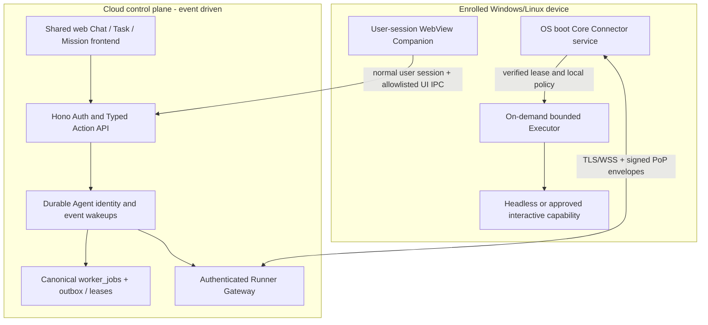

# ADR — Always-on Runner and Unified Desktop Companion

**Date:** 2026-11-02
**Status:** Proposed R1.5 product/runtime decision; not implemented or deployed.
**Scope:** New SmartAIHub Modular SaaS Windows/Linux Companion and device Core.

## Decision

“Always-on” has two meanings. Cloud Agent means durable identity, state, schedules, wakeups, recovery and controls; Workers/DOs are event-driven and may hibernate or be evicted. Enrolled device means a minimal Core Connector service starts at boot and keeps authenticated presence while powered, online and authorized. Neither meaning requires a resident model or browser.

Use three local process categories: Core Connector service, user-session Companion UI, and workload Executor launched on demand. At idle with no UI, only Core runs. With UI open and task active, all three may coexist. Cloud Agent is not a resident local process.

## Topology

## Per-OS lifecycle

| Event | Windows | Linux |
|---|---|---|
| Boot | SCM auto-starts a Service under a dedicated least-privilege identity with bounded recovery. | systemd starts a restricted system service with restart/backoff limits. |
| No login | Presence and only specifically authorized headless work; Session 0 is noninteractive. | Core may remain online; no graphical capability is implied. |
| User login | Optional Companion starts separately in the desktop session. | Optional Companion starts in user session. |
| Lock/switch user | Headless grant may continue; GUI task waits; never unlock or borrow another session. | GUI task waits when session/compositor is unavailable. |
| Sleep/network loss | Report state and reconnect after wake/recovery with jitter and fresh proof. | Same; report offline until authenticated recovery. |
| Shutdown | Core stops; Cloud Agent/job persists and waits/routes only to another authorized executor. | Same. |

Windows services must not place UI in Session 0. Tauri's autostart plugin starts a user-session application and is not the boot-service mechanism.

## Shared frontend and WebView

The Companion loads the trusted SmartAIHub frontend from an allowlisted HTTPS origin in compact and expanded routes. Web, desktop Chat, Task Control, Mission Control, thread/run inspector and Artifacts reuse the same components, tokens, typed actions, routes, APIs and canonical state. “Mirror” means shared source and IDs, not screenshot/video/framebuffer duplication or a second frontend fork.

The selected initial profile is the remote trusted frontend so web fixes arrive without reinstalling Core. Server exposes client/protocol compatibility. Incompatible versions show UPDATE_REQUIRED and disable unsupported writes. No alternate privileged bundled frontend is maintained. Offline, Core reconnect continues and the shell shows a minimal offline status without stale sensitive Chat content.

The WebView allows only exact SmartAIHub origins/routes, uses CSP and secure session/CSRF controls, blocks arbitrary navigation and exposes no device key, BYOK, shell token or generic execute(command) IPC. UI actions go through the server, never privileged localhost routes. Native IPC methods are narrow, versioned convenience calls only.

Tauri 2 remains a shell candidate. Verify WebView2 on Windows, supported system WebView on Linux, licenses, package size, startup, accessibility, security and CI support. Tray/global overlay can fail under Linux Wayland; use tray/hotkey/normal-window fallback while Core stays connected.

## Updates, resource profile and acceptance

Version Core Service, UI shell, web frontend and protocol/action contract separately. Sign packages/manifests, verify publisher and compatibility, enforce anti-downgrade, stage rollout, support signed rollback and repair without automatic re-pairing. A compatible web UI deploy does not require Core reinstall. Never auto-migrate Legacy device keys.

Measure Core RSS, CPU, wakeups, network, handles, battery/power and size on Windows and Debian/Ubuntu while locked and Companion-closed; measure separately with UI and Executor open. Set numeric budgets after a representative measured baseline. Idle has no resident LLM/browser/Executor and uses one reconnecting transport instead of needless polling. This ADR contains no measurement evidence.

Future acceptance covers unattended boot/presence, closed-UI continuation, shared thread/run reopening, disconnect/reconnect, lock/no-login boundaries, offline executor wait, revocation, invalid updates, Wayland fallback, accessibility/privacy and idle-resource baselines. No device, installer, service or deployment was changed or tested.

## Official references checked 2026-11-02

- [Windows auto-start services](https://learn.microsoft.com/en-us/windows/win32/services/automatically-starting-services), [Session 0](https://learn.microsoft.com/en-us/windows/desktop/Services/interactive-services) and [service recovery](https://learn.microsoft.com/en-us/windows/win32/rstmgr/guidelines-for-services)
- [Tauri 2 security](https://v2.tauri.app/security/), [autostart](https://v2.tauri.app/plugin/autostart/) and [signed updater](https://v2.tauri.app/plugin/updater/)
- [SPEC-325 device trust](../../specs/feature/325-smartaihub-zero-trust-always-on-agent-security/spec.md)
- [Secure Runner Connection and Device Trust ADR](SECURE-RUNNER-CONNECTION-AND-DEVICE-TRUST-ADR.md)