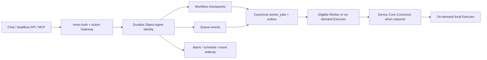

# ADR — Workers-first Durable Agents for the New Modular Platform

**Date:** 2026-11-02
**Status:** Proposed R1.5 architecture decision; not implemented or deployed.
**Scope:** New SmartAIHub Modular SaaS product only.
**Owners:** SPEC-312, SPEC-318 and SPEC-325.

## Context and decision

The new platform needs durable Agent identity, scheduled wakeups, resumable multi-step work and truthful continuation after Chat/browser closure. It does not need a resident model or a process that stays warm all day. Conflicting R1.4 Rust-native-supervisor-first claims are historical for this new product. Existing SPEC-267 Legacy migration authority and SPEC-311 Legacy cutover history are not rewritten.

1. Use independent Hono/TypeScript Workers for Core, auth/action gateways and bounded services, with private Service Bindings and explicit audience-bound caller authorization.
2. Use the Cloudflare Agents SDK on Durable Objects for durable Agent identity/state, event handling, schedules and hibernation.
3. Use Workflows for recoverable multi-step execution and sleep/retry, Queues for asynchronous transport and Alarms/Schedules/Cron for wakeups.
4. Keep worker_jobs plus transactional outbox, lease/attempt fencing, idempotency, cancellation, reconciliation and settlement as the canonical job authority. A DO is not a job ledger; a Queue is not a state store; a Workflow is not a payment system.
5. Invoke Browser Run, approved Cloudflare Containers, native Runner/Executor, external workers or GPU/media systems only when a workload needs those capabilities. Such a fallback is per task and bound by the same tenant, grant, budget and receipt.
6. Keep the device Core Connector separate from cloud Agent authority. It starts at OS boot on enrolled devices; workload Executors launch only for leased authorized tasks.

## Topology

## Lifecycle and truthful status

Cloud Agent identity and stored state remain addressable while the Durable Object is idle. Cloudflare may hibernate or evict the object; memory, timers and active callback work can disappear on eviction, deploy or crash. Work that must recover uses durable Workflow steps and canonical job/outbox/lease evidence. Every external effect is idempotent or reconciled before retry.

Closing Chat or Companion does not cancel an authorized run. A job requiring an offline, sleeping, revoked or unavailable Runner enters WAITING_FOR_EXECUTOR. GUI work without the required interactive session enters WAITING_FOR_INTERACTIVE_SESSION. It is never relabeled as running on Cloud.

Define per-tenant budgets for active goals, model tokens, queue depth, wakeups, retries, CPU, browser/executor count and spending. Recheck Cloudflare limits, costs, bindings and account availability during implementation. Do not promise unlimited scale or resident capacity.

## Existing authority and acceptance

SPEC-207 owns financial effects. SPEC-224 owns the established autonomous development control contract. SPEC-208 owns Computer Use routing. SPEC-272 remains credential Vault authority with the R1.5 new-platform key-provider adapter in SPEC-325. This ADR adds placement for the new product without rewriting these owners.

Future tests include closed-browser continuation, DO hibernation/reactivation, Workflow interruption, duplicate/lost-ACK Queue delivery, job fencing, external-effect idempotency, offline Runner wait state, revoke-before-wakeup and budget bounds. None were run in this SPEC-only revision.

## Official Cloudflare references checked 2026-11-02

- [Agents SDK runtime](https://developers.cloudflare.com/agents/runtime/)
- [Long-running Agents](https://developers.cloudflare.com/agents/concepts/agentic-patterns/long-running-agents/)
- [Agent scheduling](https://developers.cloudflare.com/agents/agent-class/schedule-tasks/)
- [Durable Object WebSocket hibernation](https://developers.cloudflare.com/durable-objects/best-practices/websockets/)
- [Workflows](https://developers.cloudflare.com/workflows/get-started/guide/) and [retry rules](https://developers.cloudflare.com/workflows/build/rules-of-workflows/)
- [Service Bindings](https://developers.cloudflare.com/workers/runtime-apis/bindings/service-bindings/)