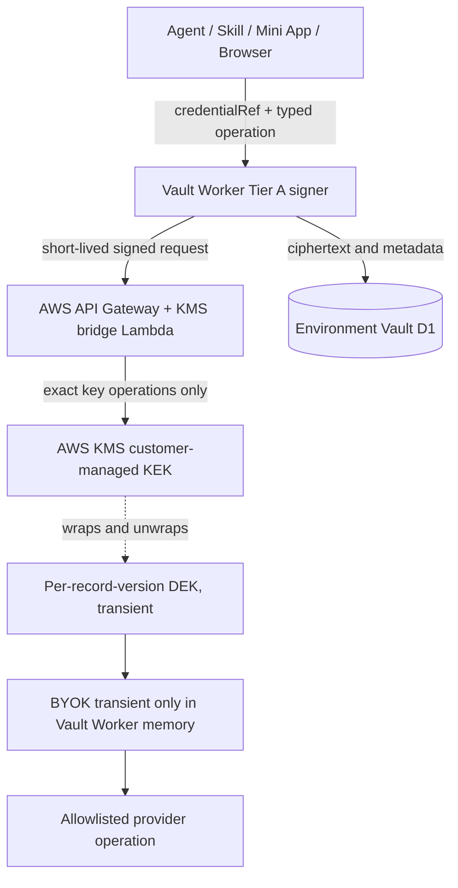

# ADR — Zero-Trust Credential and Action Authority

**Date:** 2026-11-02
**Status:** Proposed R1.5 design; no KMS, Secrets Store or Vault resource is claimed provisioned.
**Scope:** New SmartAIHub Modular SaaS platform.
**Normative detail:** SPEC-325 and existing SPEC-272 v1.1 credential-reference/provider-broker contracts.

## Decision

Use three credential tiers with separate owners and blast radii. Cloudflare Secrets Store is not the per-tenant credential database.

| Tier | Material | Boundary |
|---|---|---|
| A | Worker-specific platform keys | Cloudflare Workers Secret bindings, separate per Worker/environment and required at deploy plus runtime preflight. |
| B | A small set of shared service credentials | Cloudflare Secrets Store only when status, scopes, limits and caller binding permissions are suitable; prefer native bindings. |
| C | User/tenant BYOK and OAuth refresh | Platform-owned Credential Vault/Secure Provider Broker; app-encrypt values in dedicated environment D1 and wrap DEKs through AWS KMS behind a narrow AWS Lambda broker. |

Device proof-of-possession keys remain device-local.

## Key hierarchy and trust boundary

AWS KMS returns plaintext data keys for immediate use. The Vault Worker uses one transiently for AES-256-GCM and does not store or log it. The bridge's Lambda execution role can invoke GenerateDataKey, Decrypt and ReEncrypt only on the named environment KEK ARN. It has no Vault D1 binding and never receives BYOK. The Worker authenticates to the bridge with a short-lived, audience-bound request signed using a per-Worker Tier A secret. AWS access keys are not placed in Workers.

Use a fresh 256-bit per-record-version DEK and unique 96-bit GCM nonce. Bind AEAD additional data and KMS EncryptionContext to environment, tenant, App, credential, owner principal, provider and cipher version. Persist ciphertext, wrapped DEK, nonce, key IDs and non-secret lifecycle/grant metadata only.

Before resolving a credential, the Broker verifies caller, tenant derived from trusted identity, App, capability, provider operation, Goal/Run, budget, consent, policy epoch, expiry, revocation and destination. It repeats effect authorization immediately before an external call. No public API returns plaintext. Agent, prompt, tool output, Mini App, browser, queue, memory, notification, trace and receipt receive only credentialRef or redacted output.

Routine KEK rollover rewraps DEKs using AWS KMS ReEncrypt and retains the prior key until active rows and retained backups no longer need it. Suspected compromise also rotates/revokes the external provider credential and re-encrypts active values. Tenant deletion uses a durable tombstone reapplied to restored backups before Broker traffic resumes.

## Product facts checked 2026-11-02

Cloudflare Workers Secret bindings attach encrypted values to Workers; Wrangler secrets.required validates deployment/version upload, while local missing-secret validation warns, so runtime readiness must independently fail closed. Current Secrets Store documentation describes open beta, Workers and AI Gateway compatibility, one store and up to 100 secrets per account. Binding requires a caller permission and compatible secret scope. These limits/status must be rechecked before use. Service Binding calls do not propagate Access ctx.

AWS KMS data keys and rotation are documented services. Managed key-material rotation does not itself re-encrypt external data keys in D1; explicit ReEncrypt/rewrap and backup-retention checks remain required. The AWS broker path is a design choice, not a resource known to exist.

## Verification before implementation

Verify Cloudflare status, account limits, scopes, role rights, Wrangler compatibility and local support. Verify AWS KMS key type/region, Lambda role policy, endpoint authentication, CloudTrail, quotas/latency, retention and restore. If unsuitable, Tier C remains unavailable until another real KMS/HSM broker is selected; do not downgrade to plaintext or storage-at-rest encryption alone.

The complete placement matrix, schema, lifecycle, threat model and negative tests are normative in [SPEC-325](../../specs/feature/325-smartaihub-zero-trust-always-on-agent-security/spec.md).

## Official references checked 2026-11-02

- [Workers Secrets](https://developers.cloudflare.com/workers/configuration/secrets/)
- [Secrets Store overview](https://developers.cloudflare.com/secrets-store/), [access control](https://developers.cloudflare.com/secrets-store/access-control/), [Worker binding](https://developers.cloudflare.com/secrets-store/integrations/workers/) and [limits](https://developers.cloudflare.com/workers/wrangler/commands/secrets-store/)
- [Service Bindings](https://developers.cloudflare.com/workers/runtime-apis/bindings/service-bindings/)
- [AWS KMS data keys](https://docs.aws.amazon.com/kms/latest/developerguide/data-keys.html), [KMS rotation](https://docs.aws.amazon.com/kms/latest/developerguide/rotate-keys.html) and [Lambda execution roles](https://docs.aws.amazon.com/lambda/latest/dg/lambda-intro-execution-role.html)