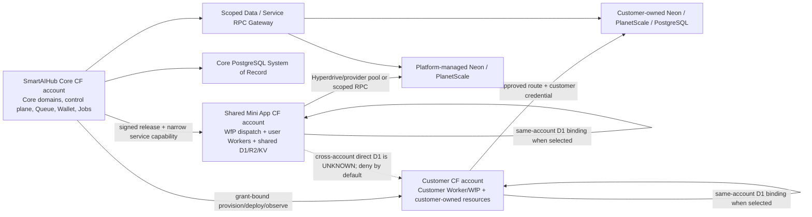

# SmartAIHub Cloudflare Multi-Account and Mini App Database Ownership Review

**Review date:** 2026-10-22 (Asia/Bangkok)
**Source revision:** `029c3c9efab1941d1966e7539f702c07330fc10c` (`origin/main`)
**Scope:** SPEC and code audit plus additive amendments; no production data, Cloudflare resources, deployment, or migration were touched. No new SPEC or billing/provisioning control plane is introduced.

The ten affected existing Spec handoffs were reconciled against their updated normative digests. Newly discovered requirements remain open/unverified; no implementation, verification, deployment or acceptance state was promoted.

## Executive decision

SmartAIHub Core, the shared Mini App fleet, customer Cloudflare accounts, and each Mini App database are separate placement and ownership decisions. The Core account owns only Core resources. Production shared Mini App compute belongs in a distinct shared Mini App Cloudflare account. A customer BYOC deployment is managed under a scoped grant while the customer retains resource ownership. Database provider, database owner, database payer, compute account, and credit payer are independent attributes.

Use **Workers for Platforms (WfP)** for the large shared fleet of untrusted or generated app Workers. Keep ordinary Workers for the small, curated set of platform services and dispatch/control Workers. Standard Workers have a documented 500 Worker per-account Paid-plan limit; WfP dispatch namespaces remove the per-account script limit for their user Workers and provide default untrusted isolation, custom per-user-Worker limits, and a central dispatch layer. These properties fit the fleet use case. WfP is not a blanket requirement for customer BYOC: use it only when the customer's plan and grant support it; otherwise use a bounded standard Worker deployment or return a clear unsupported-capacity result.

Keep Core's persistent business and economic source of truth on the Core PostgreSQL/control-plane path. Use Cloudflare Queues and Workflows for asynchronous delivery and orchestration, with `worker_jobs` plus outbox as durable execution authority. Use D1 for Mini App data only when its limits, workload and consistency profile fit; platform-managed Neon or PlanetScale and customer-owned PostgreSQL remain supported by SPEC-273's portable data contract. A D1 binding must target an authorized resource in the account used for deployment. Cross-account native D1 binding is **UNKNOWN** from available official documentation and must not be assumed; use a customer-account D1 binding or a scoped gateway/RPC capability.

The inspected implementation already has Cloudflare account-scoped native resource provisioning primitives and a Cloudflare runtime using Hyperdrive, Queue/Workflow, Container and other injected bindings. It does not prove a production WfP Mini App deployment adapter, end-to-end customer BYOC lifecycle, or Mini App database provisioning/ownership matrix. The Wrangler production template currently has one Hyperdrive binding path, a Queue and a KV binding; it has no D1 binding. Existing Hyperdrive configuration limits make one Hyperdrive configuration per app an invalid fleet design.

## 1. Current implementation gap analysis

| Surface | Observed evidence at source SHA | Assessment |
|---|---|---|
| Core Cloudflare runtime | `apps/cloudflare/src/bindings.ts`, `contracts.ts`, `queueConsumer.ts`, `workflowRuntime.ts`; production Wrangler template has runtime routes, Queue, KV and injected Hyperdrive | Core runtime path exists as a capability-injected adapter; production activation is explicitly disabled in the checked-in template. It is not a Mini App account topology. |
| Account-specific resource provisioning | `apps/web/server/services/cloudflareNativeProvisionTransport.ts`, `cloudflareNativeProvisionExecutor.ts`, `cloudflareCredentialCenter.ts`, `python-backend/app/services/cloudflare_staging_policy.py` | Account-scoped API resource operations and credential/policy checks exist for the staging/native resource path. This does not prove a general WfP app upload, customer lifecycle or complete BYOC product. |
| Shared Mini App deployment | SPEC-219 describes WfP dispatch and BYOC; no WfP dispatch/user-Worker deployment adapter was found in `apps/cloudflare` or the inspected web services | Normative target exists; implementation proof is missing. Keep as a SPEC/roadmap gap. |
| Database options | SPEC-273 supports D1, SQLite, PostgreSQL and BYODB; Core runtime code uses Hyperdrive/PostgreSQL. Wrangler production config has no D1 binding | Portable target exists, but the reviewed Cloudflare runtime is PostgreSQL-centred and does not prove automatic Mini App backend selection/provisioning. |
| Hyperdrive scale | Official docs state 25 configured databases per Paid account; `apps/cloudflare/src/hyperdrive.ts` caps local client pool settings but does not implement a fleet connection registry | Do not allocate one config per app. Pool only by actual shared origin DB, use provider-native pooling, or a bounded gateway. Dedicated origins require a quota-aware exception. |
| Economics | SPEC-207 owns authorization, budget, reservation, ledger and settlement; SPEC-280 owns meter/billability/pricing/allocation. Existing ledgers still identify implementation work as incomplete | Integrate provider evidence into those owners. Do not create another wallet, meter, provider-billing ledger or provisioning engine. |
| Long-running lifecycle | SPEC-224 / Feature 195 and `worker_jobs`+outbox are existing execution authorities | Provision, migration, deploy, recovery and cleanup operations that outlive a request must become durable jobs with idempotency, fencing and evidence. |

“Not found in the inspected paths” is not proof that no code exists elsewhere; the statements above are scoped to targeted `rg` and file inspection on the recorded source revision. No specialized code index was used; targeted repository search was the discovery fallback.

## 2. Account topology and trust boundaries



**Trust rules:** Core credentials never become user-Worker bindings. The shared dispatch Worker authenticates and resolves app identity before dynamic dispatch; user Workers run untrusted and receive only declared bindings/capabilities. BYOC tokens are held in SPEC-272's vault/broker, bound to customer tenant, Cloudflare account, environment, resource class, allowed operations, expiry and revocation epoch. Service binding/RPC is a capability, not an identity propagation mechanism: downstream services must authorize the explicit scope envelope. Cross-account deployment must preflight the target account from the grant, not from a mutable app payload.

Development may temporarily use one Cloudflare account for Core and shared Mini Apps. It must use distinct account profiles, bindings, resource IDs, secrets, environments and deployment targets; no business logic may infer account identity from a default credential. Production config validation must reject identical Core/shared account IDs unless an explicit non-production profile is active.

## 3. Deployment mode matrix

| Mode | Compute account / owner | Recommended use | Limits and trust controls |
|---|---|---|---|
| Core standard Worker | Core / platform | Dispatch, Core APIs, runtime control plane, trusted first-party services | Keep small and curated; standard Workers Paid documents 500 Workers per account. No arbitrary tenant code. |
| Shared Mini App WfP | Dedicated shared account / platform | Default for many generated or untrusted Mini Apps | One production dispatch namespace is preferred; staging is a separate namespace. Per-app CPU/subrequest limits, egress policy, tenant routing, response sanitation, tags and observability are mandatory. |
| Shared standard Worker | Dedicated shared account / platform | Curated, trusted apps or low-volume pilot | Not the default factory fleet; script/account limits and per-script operations are the scale boundary. Admission must reserve script capacity. |
| Customer BYOC standard Worker | Customer / customer | Customer-owned account without WfP entitlement or when a small deployment fits | A customer-granted, least-privilege token permits only scoped operations. Resource ownership and provider bill remain customer-owned; revoke must stop future management calls without deleting resources. |
| Customer BYOC WfP | Customer / customer | Customer explicitly enables WfP and wants dispatch isolation/scale | Require capability/plan preflight, namespace boundary, service continuity and cost disclosure. SmartAIHub must not purchase or enable plan features on the customer's behalf without explicit authority. |

WfP is the appropriate fleet compute plane because it targets programmable platforms, provides unlimited user Workers in a dispatch namespace, default untrusted isolation and per-user limits. Standard Workers remain the cheaper/simple option for Core's finite first-party services. WfP paid pricing shown in current docs is a $25 monthly subscription including 20 million requests, 60 million CPU milliseconds and 1,000 scripts, with published overage rates; validate live plan, add-ons and account-specific terms before admission. Those figures are changeable and are not a quote or budget approval.

## 4. Database ownership and provisioning matrix

| Database mode | Resource owner | Provider bill payer | Default access | Suitable profile / guard |
|---|---|---|---|---|
| Shared-account D1 | SmartAIHub platform | Platform Cloudflare account | Native D1 binding from same shared account; or narrow service RPC | Dormant/low/small apps; per-app tenant isolation, row/data limits, backup/restore, query metering and fair-use admission. |
| Customer-account D1 | Customer | Customer Cloudflare account | Native binding only when Worker is deployed in that same customer account; otherwise scoped gateway if supported | Customer BYOC; customer owns data and bill. Cross-account direct binding remains UNKNOWN and is rejected pending proof. |
| Platform Neon | SmartAIHub platform | Platform | Pooled provider endpoint; Hyperdrive only when the origin/config grouping and quota fit; otherwise approved gateway | Shared/dedicated PostgreSQL workloads; platform remains accountable for metering, quotas, reconciliation and credit exposure. |
| Platform PlanetScale | SmartAIHub platform | Platform | Provider-native pooling (including transaction pool where supported); optional Hyperdrive after compatibility certification | Managed PostgreSQL growth/high availability or MySQL/Vitess only when package SQL profile supports it. Use live quote for HA. |
| Customer Neon / PlanetScale | Customer | Customer | Customer-supported pooled endpoint through approved secret and route | BYOD; SmartAIHub service charges may apply, but provider usage must not be charged again. |
| Customer PostgreSQL / other BYOD | Customer | Customer | Customer-managed network route and secret; Hyperdrive, provider pool or scoped gateway only after certification | Existing enterprise DB/read-only, schema-managed, or full authority as separate grants. Private networking, TLS, firewall and transaction semantics are mandatory. |
| Platform shared logical DB | SmartAIHub platform | Platform | Tenant-scoped DAL/gateway; no raw tenant DSN or cross-tenant SQL authority | Economical small/growing apps if isolation, noisy-neighbor and export acceptance pass. Never the Core System of Record by default. |
| Dedicated DB | Named platform or customer owner | Same declared payer | Isolated connection identity/pool and quota | High load/enterprise or residency/security requirement; provision only after approved budget and isolation evidence. |

The compute account, database owner, database bill payer, service provider and customer-credit payer must be separate persisted references. Ownership does not transfer on connection. `BYO` connection does not grant DDL, backup, migration, delete or export authority by implication.

## 5. Data access strategy and acceptance criteria

| Strategy | Best fit | Security and transaction rule | Acceptance evidence |
|---|---|---|---|
| Native D1 binding | D1 database in the Worker deployment account | Resource ID is account-scoped; binding grants direct database capability. Parameterized SQL, tenant/app isolation and migration authority still apply. | Wrong account/resource ID is rejected before deploy; per-tenant isolation and D1 overload/limit handling pass; `batch()` and transaction semantics verified. |
| Hyperdrive | PostgreSQL-compatible origin that needs connection pooling and optional query cache | Connection pooling is per Hyperdrive config/origin. Do not route lease, billing or canonical status reads through cache. Keep external calls outside DB transactions. | Connection exhaustion and failover are bounded; transaction isolation/retry/idempotency, TLS, cache freshness and per-origin quota pass. |
| Provider-native pool | Neon pooled endpoint; PlanetScale PostgreSQL PgBouncer transaction pooling; PlanetScale Vitess/routers where appropriate | Confirm session-affine features, prepared statements, advisory locks, temp tables, `LISTEN`, transaction boundaries and retry semantics for the selected mode. | Compatibility suite for the actual driver/ORM and migration tool; max-client/server connection and saturation test; provider failover behavior. |
| Secure DB gateway | Customer DB behind a private network or central metering/policy requirement | Allowlisted tenant/app/database and operation scope, short-lived credential/capability, prepared SQL or typed RPC, egress restrictions; never accept caller-supplied arbitrary DSN. | Tenant/object authorization on every call; latency/availability/cost envelope; transaction API limitation documented; full audit and revocation test. |
| Service/RPC capability | Runtime needs a narrow business operation rather than SQL | Scope and business action are explicit; gateway re-authorizes current tenant/project/app permissions. | Cross-tenant denial, capability expiry, replay/idempotency and provider outage behavior. |

**Hyperdrive limits verified from official docs (checked 2026-10-22):** Paid plans currently allow 25 configured databases per account, approximately 100 origin DB connections per configuration, 60-second query duration and 50 MB cacheable responses. It does not limit Worker-side client connections. Pool counts are soft maxima and can occasionally exceed the nominal count during network recovery. These limits rule out one config per Mini App as a default. A shared config is valid only when those apps truly use the same origin database/credential/security boundary. Use a managed shared DB or provider pool/gateway for large numbers of apps; reserve per-customer configs for bounded dedicated cases. Recheck limits before provisioning.

Across all strategies, acceptance requires: (1) tenant/app authorization and isolation; (2) database transaction semantics and idempotent retry; (3) a measured p50/p95 latency budget in representative regions; (4) bounded connection/queue wait and overload behavior; (5) per-app/account cost attribution; (6) verified export/restore; and (7) explicit handling of provider outages and uncertain commits. Product-specific numeric latency and loss budgets remain **UNKNOWN** until a workload pilot and owner approval; a release cannot silently invent them.

## 6. Resource/billing ownership data model

Use existing resource registry, provider credential, SPEC-207 economic, SPEC-280 meter, SPEC-224 job and SPEC-295 deployment authorities. Extend their contracts rather than create a new ledger or provisioner. Required references/fields:

```text
AppPlacement(app_id, release_id, deployment_id, environment,
  runtime_provider, runtime_account_owner, runtime_account_ref,
  deployer_authority_ref, deployment_class, wfp_namespace_ref,
  region/residency, status, version, created_at, updated_at)

DataPlacement(app_id, binding_id, logical_store, provider, engine,
  resource_ref, resource_owner_class, resource_owner_ref,
  provider_bill_payer_class, provider_bill_payer_ref,
  access_strategy, credential_ref, isolation_mode, authority_grant_ref,
  budget_policy_ref, quota_ref, schema_version, residency,
  lifecycle_state, portability_level, last_reconciled_at)

UsageAttribution(event_id, job_id, app_id, tenant_id, deployment_id,
  resource_ref, provider, metric, quantity, source_event_ref,
  observed_at, source_watermark, confidence, price_snapshot_ref,
  bill_payer_ref, customer_credit_payer_ref, settlement_ref)
```

Resource owner, provider bill payer, SmartAIHub service provider, customer credit payer, and actor with lifecycle authority are distinct nullable references with typed owner classes. Secret values are never included. Append-only provider observations must be deduplicated by provider event identity plus content digest; late corrections create adjustment/reconciliation events and never rewrite settled history. Unknown ownership or a missing grant blocks mutation/deletion.

## 7. BYOC and BYO database lifecycle

1. **Connect:** customer selects account/provider and environment; record owner, payer, residency, intended operations and allowed resource classes.
2. **Validate:** verify account identity and exact permissions using a read-only probe; require least-privilege token scopes, expiry/rotation path and owner confirmation. No global API key.
3. **Provision:** resolve an immutable plan and cost ceiling; idempotency key prevents duplicates; tag resources with app/deployment/tenant/owner/expiry where provider supports tags. Database schema changes require separate DDL/data authority.
4. **Configure:** bind resource to exact deployment and access strategy; publish no DSN to app source or prompt; validate TLS/network path, database and driver compatibility.
5. **Deploy and meter:** durable SPEC-224/worker-job execution; record artifact, resource and policy snapshot. Capture provider usage plus SmartAIHub service usage with source watermarks and confidence.
6. **Scale/optimize:** scale only inside approved quota and budget envelope. If projected spend, provider quota or saturation breaks the envelope, restrict new admission before increasing spend.
7. **Suspend/restrict/resume:** retain customer resources and data. Suspend only app execution/credentials under explicit authority; resume after fresh account/permission, quota, cost and schema compatibility checks.
8. **Migrate:** no automatic provider or account migration. Require source and destination authority, cost/budget admission, schema/data mapping, backup/PITR, consistency proof, cutover plan, rollback point, export and customer-visible consent.
9. **Archive/delete:** archive is reversible and preserves owner data/export access. Delete is provider-specific, owner-authorized, delayed where policy requires, and verified by resource reconciliation. For customer-owned resources, disconnection disables SmartAIHub access and leaves the resource intact; deletion requires a separate explicit grant and confirmation.
10. **Reconcile:** periodic orphan and drift inventory is read/observe by default. Mutating remediation is an audited job under the same owner/grant/budget; unreconciled provider state remains visible as UNKNOWN.

Every transition binds tenant, app, environment, actor, operation, resource scope, policy, budget, expiry, idempotency key and audit evidence. Provider failures retry only when the operation is idempotent or provider state has been read back. Do not claim zero-loss metering: provider usage exports can be delayed or corrected after internal settlement.

## 8. Economic controls and settlement

When SmartAIHub pays a provider, SPEC-207 admission reserves a conservative bounded exposure before provision/compute/database use. SPEC-280 supplies the billable usage, rate-card snapshot and allocation facts. Enforce account, tenant, app, provider, resource, concurrency and period quotas. Forecast against observed usage and committed fixed cost; apply a margin guard and abnormal-usage alert; settle from deduplicated provider evidence; reconcile invoice totals and late adjustments. Reservation is not proof of exact final provider cost.

When the customer pays Cloudflare/Neon/PlanetScale directly, do not bill that same provider usage through customer credits. Bill only the agreed SmartAIHub platform/service/skill/AI/managed-service rate card. If a Customer-owned Worker can access a platform-managed DB through an unmetered direct path, prohibit direct credentials: require the scoped DB gateway/RPC capability or move the DB into the customer account. Otherwise the platform cannot truthfully meter or enforce credit admission.

Provider reporting delays mean **zero loss is not guaranteed**. Apply usage watermark freshness, conservative exposure holds, per-app hard quotas, pause thresholds, delayed finalization where supported, and explicit variance reconciliation. Late usage posts an adjustment; it does not silently debit an unreserved amount. On uncertain provider state, mark settlement pending, prevent duplicate execution and bound further exposure under the existing economic authority.

## 9. Cloudflare-native workload and cost scenarios

Persistent business state stays in Core PostgreSQL (tenant, authorization, wallet/ledger, worker jobs/events, outbox, deployment/release metadata and audit). Transient execution state belongs to Queues, Workflows, Container ephemeral state or Durable Objects only where their lifecycle/consistency fits; KV is cache/config projection, R2 is object/artifact store, Vectorize is rebuildable index. Do not mirror canonical status into multiple polling stores.

Reduce polling/heartbeats by using Queue delivery and event-driven state transitions, bounded lease renewal only for active work, event-based wakeups, batch writes, compare-and-set/unique constraints, and projection checkpoints. Keep one authoritative transition per event; logs/traces are sampled projections, while financial/security/audit facts remain durable. A Queue or Workflow receipt is transport/execution evidence, not a replacement for `worker_jobs` state.

| Scenario | Core cost drivers | Mini App fleet cost drivers | Admission/economic posture |
|---|---|---|---|
| Dormant/low use | Core Worker/control-plane baseline, Core PostgreSQL HA, minimum observability/backup and queue resources | WfP base/script count; near-zero app compute; D1 storage or DB fixed cost remains | Prefer lazy DB provisioning, archive expired previews; never keep dedicated DBs for dormant apps without an approved reason. |
| Small active/shared | Same Core baseline plus Queue/Workflow and measured DB operations | WfP request/CPU overage, D1 rows read/written/storage, shared R2/KV, provider pool capacity | Shared Mini App account and logical DB; per-app quotas and tenant isolation; reserve customer credits if platform pays provider. |
| Growing | Increased Core job/event volume and Core DB capacity/pool | D1 single-database serial bottleneck, WfP usage, gateway/provider pool, backup/storage/egress | Split app data only with app-level routing and portability proof; move to managed PG when measured workload exceeds approved fit. |
| High load/dedicated | Core DB/worker scaling, replicas, HA/DR, Hyperdrive pools and support | Dedicated DB/connection budget, observability, WfP compute and possible dedicated resource quota | Explicit budget, provider quote, SLO, margin, rollback and quota grant before scale. Auto-scale remains bounded by prior approval. |
| Enterprise/BYOC | Core service cost only for agreed management/control; no customer provider pass-through | Customer's direct provider invoice plus optional SmartAIHub service fees; customer network/security operations | Customer owns data/resources. Export, audit, isolation, residency and exit runbook are required. |

Do not translate the current server deployment's SQL query/poll counts directly into Cloudflare production spend. Price models differ by billed metric: WfP request/CPU/scripts; D1 rows and storage with scale-to-zero; Neon compute/storage/branch/transfer terms; PlanetScale topology/CPU/storage/pool and HA quote; Hyperdrive account configuration/connection capacity; plus Queues, Workflows, Containers, DO, KV, R2, Vectorize, logs and egress. Keep Core DB and Mini App fleet cost models separate and refresh provider prices at admission/quarterly review.

## 10. SPEC ownership crosswalk

| SPEC / owner | Existing authority confirmed in registry/text | This review disposition |
|---|---|---|
| 207 | Economic authorization, budgets/reservations, ledger and settlement | Amend only platform-paid provider exposure and late-cost reconciliation. |
| 280 | Meter definitions, usage evidence, billability, price snapshot and revenue allocation | Amend Cloudflare/DB usage source and no-double-bill rules. |
| 267 | Cloudflare production migration and durable execution control plane; Core workload and Hyperdrive production boundary | Clarify Core vs Mini App workload/account separation and prevent transplant of old server cost assumptions. |
| 272 | Credential vault, provider broker, token lifecycle and secret authority | Amend customer Cloudflare/provider account connection, least privilege, rotation and revocation. |
| 224 + Feature 195 | Development lifecycle and canonical durable `worker_jobs`/outbox execution | Consume lifecycle operations as durable, authorized jobs; do not add another scheduler. |
| 271 | Portable UAT/acceptance execution and evidence | Consume the matrix and preserve evidence freshness/ownership; no competing app acceptance engine. |
| 219 | Managed tenant runtime, WfP deployment, BYOC and runtime governance | Primary Cloudflare topology/compute-mode owner; amend here. |
| 220 | Tenant data/capability/security gateway | Owns scoped gateway/RPC and data authorization boundary; amend data access rules here. |
| 261 | Portable Mini App package, declared resources, capabilities and lifecycle contract | Require account/data placement and portability intent in package declaration. |
| 273 | Mini App data architecture, Storage Resolver, database ownership, migration/authority | Primary database selection and ownership owner; amend here. |
| 288 | Resource Fabric and portable resource contracts | Owns resource identity, ownership references, lifecycle and capability composition; amend data model here. |
| 295 | Production release, deployment, migration and runtime operations | Owns real deployment/migration/change controls; consume lifecycle evidence, no provider bypass. |
| 304 | Stable App identity, release/deployment/domain references | Bind `app_id`, release and deployment IDs to placement/resource references. |
| 209 / 216 | Workflow Studio/Mini App product and node/runtime contracts | Product authoring/execution surface only; consume 261/219/273/224 without taking provider ownership. |

Other discovered Mini App-related entries include 217–220, 242, 265, 281 and 287; they remain bounded to their product, runtime, gateway, domain-app, knowledge or UI contracts. SPEC-265 is an example vertical Mini App, not platform database authority. SPEC-273 is the data architecture authority omitted by the initial candidate list. No duplicate SPEC is proposed.

## 11. Acceptance criteria and 24-case deployment/database test matrix

Deployment columns: **S-WfP** = shared WfP account; **S-Std** = shared standard Worker account; **C-WfP** = customer WfP account; **C-Std** = customer standard Worker account. Database rows: **D1-S** = shared-account D1; **D1-C** = customer-account D1; **PG-P** = platform-managed Neon/PlanetScale PostgreSQL; **PG-C** = customer-owned Neon/PlanetScale; **BYOD-PG** = customer PostgreSQL; **DB-S** = platform shared logical DB. Each cell is a distinct deployment/database ownership combination and must assert the listed path or fail closed.

| DB \ Deployment | S-WfP | S-Std | C-WfP | C-Std |
|---|---|---|---|---|
| D1-S | Native binding; isolation/quota | Native binding; script admission | Gateway only; cross-account native denied/UNKNOWN | Gateway only; cross-account native denied/UNKNOWN |
| D1-C | Gateway; never assume cross-account binding | Gateway; never assume cross-account binding | Same-account customer binding only if DB and Worker account match; otherwise gateway/deny | Same-account customer binding only if DB and Worker account match; otherwise gateway/deny |
| PG-P | Hyperdrive shared-origin quota or provider pool/gateway | Same; Hyperdrive config count tested | Scoped gateway; ensure customer Worker cannot bypass meter | Scoped gateway; ensure customer Worker cannot bypass meter |
| PG-C | Customer secret + approved network/gateway | Same | Same-account/private route and grant check | Same-account/private route and grant check |
| BYOD-PG | Customer secret + private route/gateway | Same | Customer-owned route and authority | Customer-owned route and authority |
| DB-S | Tenant-scoped DAL/gateway; no raw DSN | Same; script admission | Gateway only; provider access metered | Gateway only; provider access metered |

For **all 24 cells**, tests must cover account/owner identity binding, tenant isolation, unauthorized cross-tenant resource access, credential redaction, provider failure, duplicate provision idempotency, billing ownership, migration authority, cost/quota enforcement, and audit evidence. Applicable cases additionally cover WfP namespace/worker isolation, standard account script exhaustion, BYOC connect/revoke/disconnect with ownership preservation, D1 serialization/overload/limits, Hyperdrive config exhaustion and pool loss, provider-native pool session semantics, gateway latency/revocation, cross-account denial, and DB export/restore. “N/A” is permitted only with a reasoned applicability record; unsupported combinations must return a typed denial without resource creation.

Additional suites: Core/shared-account separation; temporary one-account development config; provider API outage and unknown commit; duplicate `PROVISION` requests; platform-paid credit reservation and final reconciliation; customer-paid no-double-billing; late invoice correction; cost overrun; quota enforcement; authorized scale/suspend/resume; suspended app recovery; orphan detection; customer exit/data portability; Cloudflare account/token revocation; and D1/PG migration consistency. Run only in mocked or isolated non-production environments with no real spend; each proof binds source SHA, profile, command/scope, timestamp, resource owner/payer, outcome and redacted evidence. Do not report any of these as passed until executed.

## 12. Implementation roadmap

1. **Reconcile normative ownership (now):** accept these additive clauses in SPEC-219/220/261/267/272/273/288/295 and SPEC-207/280; update the existing Spec handoffs through the shared writer and retain their current incomplete states.
2. **Contract/model slice:** extend existing account/deployment/resource records with independent owner, payer, placement, authority, credential-reference, budget, quota, portability and usage-watermark fields. Add schema/API compatibility decisions under each owner; no new wallet or provisioning system.
3. **Non-production control-plane adapters:** implement WfP upload/dispatch and customer-account API flows using SPEC-272 grants; implement D1 binding for same-account workers; preserve idempotency and durable job/outbox execution. Mock provider calls first.
4. **Database adapter certification:** provider pool/Hyperdrive/gateway conformance; transaction, access, connection, outage and latency tests. Use shared DB/pools before dedicated DB creation; enforce Hyperdrive configuration caps.
5. **Economic integration:** SPEC-280 meter facts -> SPEC-207 reservation/settlement, invoice reconciliation and margin/abnormal-use guard; test late or missing provider reports and no-double-billing.
6. **Lifecycle and operations:** provision/configure/deploy/meter/scale/restrict/resume/migrate/archive/delete with authority and audit; SPEC-295 owns deployment/migration and customer-owned deletion remains explicit opt-in.
7. **Acceptance/rollout:** execute 24-cell matrix at a scoped non-production profile; record `UNKNOWN` for unavailable provider/API/plan proof. Pilot dormant, small and growth profiles separately; do not infer production cost or readiness from current server workload or a passing build.

## 13. Ten-round gap review record

| Round | Independent review surface | Finding and resolution in this revision |
|---|---|---|
| 1 | Account topology | Core and Mini App accounts were implicitly conflated; separated Core, shared fleet and customer accounts, with explicit dev exception. |
| 2 | Compute scale/isolation | Standard Worker account script cap does not fit a large generated fleet; WfP selected for shared untrusted apps, standard Workers retained for finite trusted services. |
| 3 | BYOC trust | Account connection could be confused with ownership transfer; grant, owner, payer, operation and disconnect semantics are separated. |
| 4 | Database ownership | Database choice was coupled to deployment; owner/payer and database provider are independent; SPEC-273 confirmed as owner. |
| 5 | Cross-account binding | Direct D1 use across accounts lacked official proof; marked UNKNOWN and denied by default; same-account binding or gateway is required. |
| 6 | Pool/configuration scale | Hyperdrive config cap invalidates config-per-app; shared-origin grouping, provider pooling, gateway and dedicated exception are defined. |
| 7 | Transactions/security | DB strategies differ in transaction/session behavior; each strategy gets compatibility, isolation, latency and saturation acceptance. |
| 8 | Cost/settlement | Customer-paid provider usage risks double billing; split payer fields, reservation, meter source and late invoice adjustments under existing SPEC owners. |
| 9 | Lifecycle/data safety | Auto-migrate/delete could cross authority; budgeted scale only, migration requires consent/consistency/rollback, customer disconnect preserves resources. |
| 10 | Workload/spec/code consistency | Old server SQL assumptions could be projected onto Cloudflare; Core persistence is separated from transient execution; 14 SPECs crosswalked and gaps mapped to implementation evidence. |

Rounds were performed as ten sequential documented gap passes against the brief, current Specs/hand-offs, targeted implementation and current official documentation. They are architecture review passes, not independent reviewers, automated security testing, runtime proof, or provider certification.

## 14. Official documentation and evidence limits

Documentation checked on 2026-10-22:

- Cloudflare [Workers for Platforms overview](https://developers.cloudflare.com/cloudflare-for-platforms/workers-for-platforms/), [architecture and dispatch namespace guidance](https://developers.cloudflare.com/cloudflare-for-platforms/workers-for-platforms/how-workers-for-platforms-works/), [bindings](https://developers.cloudflare.com/cloudflare-for-platforms/workers-for-platforms/configuration/bindings/), and [pricing](https://developers.cloudflare.com/cloudflare-for-platforms/workers-for-platforms/reference/pricing/).
- Cloudflare [standard Worker limits](https://developers.cloudflare.com/workers/platform/limits/), [Hyperdrive limits](https://developers.cloudflare.com/hyperdrive/platform/limits/), [D1 limits](https://developers.cloudflare.com/d1/platform/limits/), [D1 pricing/usage metrics](https://developers.cloudflare.com/d1/platform/pricing/), [D1 bindings](https://developers.cloudflare.com/d1/get-started/), and the [account-scoped D1 API](https://developers.cloudflare.com/api/resources/d1/subresources/database/methods/create/).
- Neon [pooled connection URI API](https://api-docs.neon.tech/reference/getconnectionuri) (documents `pooled=true`; exact runtime and pricing acceptance remains plan/region dependent).
- PlanetScale [current pricing/catalog](https://planetscale.com/pricing), [Postgres architecture](https://planetscale.com/postgres), and [PgBouncer pooling guidance](https://planetscale.com/blog/scaling-postgres-connections-with-pgbouncer).

**UNKNOWN / not claimed:** cross-account D1 native binding support; current account-specific WfP/Workers/D1 entitlement and approved quotas; customer token exact scopes required for the intended deployment path; live Neon/PlanetScale regional quotes; provider reporting delay/accuracy guarantees; customer database private-network reachability; platform-specific numeric latency/loss thresholds; production WfP adapter behavior; full BYOC disconnect, rotation, revocation and data portability proof. These require targeted provider/account evidence before implementation admission or production claims.
