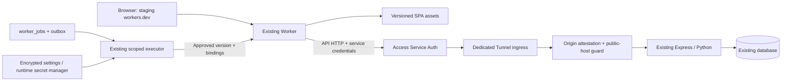

# Cloudflare origin and authentication completion

Use the existing Worker as the browser's same-origin frontend/API entry. Keep the Linux Express/Python backend and database authoritative. This closes the immediate auth gap; it does not certify that every backend service has moved to Cloudflare.

## 1. Session correctness

Keep workers.dev cookies host-only. The focused defect is already repaired independently; see parent HANDOFF for the integrated source. Continue by proving the public request host survives the real proxy chain and controls cookie/tenant selection only after attestation. Preserve production shared-domain behavior. Before adding a custom staging subdomain, explicitly prevent staging sessions from reading/overwriting production parent-domain cookies; host-only alone does not stop an inherited parent-domain cookie from being sent to that subdomain.

Use the actual auth routes from client and server source: `/trpc/auth.login`, `/trpc/auth.me`, `/trpc/auth.logout`, pending 2FA and the configured Google/GitHub callback flows. Inventory the applicable refresh/revocation path rather than assuming the generic Worker proxy test URLs are real endpoints.

## 2. Protected origin and request context

Provision a dedicated origin ingress, proposed `origin-staging.smartaihub.app`, routed through a named Tunnel to the existing backend. Protect its Access application with Service Auth restricted to this staging service token. Enable cloudflared Access JWT validation for this ingress using its actual team/AUD. Do not edit other ingress entries or set noTLSVerify. A hostname and shared secret alone do not make an endpoint network-private.

Extend `AuthOriginProxyConfig` and Worker environment types with proposed `AUTH_ORIGIN_ACCESS_CLIENT_ID` and `AUTH_ORIGIN_ACCESS_CLIENT_SECRET`. These do not exist yet. Require the pair atomically in Access mode, strip any caller-supplied Access/trust headers, then inject only server-resolved values. Preserve the application's Authorization and cookies. Never cache authenticated/session responses or trust an upstream public-cache directive for auth; keep auth, secrets and error responses private/no-store, and verify dynamic API cache bypass separately from immutable assets. Pin the HTTPS origin/host and reject self-recursion, URL credentials, paths, queries and foreign redirect targets. Handle Access-denied redirects/HTML as a sanitized upstream-unavailable result while preserving legitimate application OAuth redirects.

Enforce app attestation on the dedicated origin ingress even when its token header is absent. Keep legacy public production requests working. Use a verified ingress/public-host discriminator; neither a forged Host nor an unsigned X-Forwarded-Host can select the privileged path. Derive the public host from the Worker request, sign/attest it using the dedicated trust boundary, validate an exact public-host allowlist at the origin, and resolve it through the existing tenant domain authority. Strip untrusted forwarding headers before any tenant/CSRF/rate-limit decision. Verify the actual cloudflared → application chain; do not solve this by globally trusting every proxy.

Retain a response-header deadline and caller cancellation. Qualify upload/SSE body lifetimes separately so a cleared header timer does not strand a body or kill a valid stream. Never automatically replay a state-changing POST after an ambiguous upstream failure. Keep native-only WebSocket routes out of any claim of full HTTP feature parity until their existing runtime ingress or a separately tested Worker bridge is qualified.

## 3. Scoped configuration, secrets and deployment

Reuse `provider_deployment_targets.runtimePolicy` as a short reference to a versioned origin descriptor in existing settings; scope every lookup to tenant/project/environment/account/worker. Descriptor fields: schemaVersion, origin, privateHost, allowedPublicOrigins, Access application/team/AUD references, credential reference and configuration version. The canonical configuration digest includes secret-version references, never plaintext values. Reject unknown/mismatched scope, unencrypted secrets and missing/revoked versions. Keep origin attestation, Access Client ID/Secret, deployment API token, R2 S3 secret and canonical job control-plane token as separate purposes.

Use the existing encrypted system_settings mechanism with an explicitly scoped immutable key/version or approved runtime secret manager. Admin reads return metadata only; exact Admin/owner guards remain. Resolve secrets only in the execution callback. No .env copies into source/builds, no VITE_ secret names and no unredacted provider errors or command arguments.

Extend the existing typed grant/policy contract explicitly for origin configuration and action/resource scope; retain v1 artifact-only behavior. Bind exact config digest and secret-version references to the job, executor proof, active target and deployment receipt. Recheck owner/policy, lease/deadline, revocation and unchanged configuration before every external mutation. Compose the approved origin bindings in every uploaded Worker version. Preserve canonical artifact source/digest separately from runtime configuration digest; one cannot stand in for the other.

Use version upload plus the existing canonical activation step for secret changes. Direct `wrangler secret put` can deploy immediately and is not an authorized substitute. Before rollback, validate the prior artifact AND origin/config/secret versions still exist and are compatible. Account for the backend and Access policy, which a Worker rollback does not restore.

## 4. Provision and release in a recoverable order

Read actual effective provider permissions first. Fresh exact GETs for both locally configured Tunnels returned HTTP401/code1001 despite HTTP200 empty list endpoints, so listing success is not a reuse/management authority. Separate Workers upload authority from Tunnel, Access application/policy/service-token, zone DNS and origin-service release authority. Reuse existing Admin credentials only when their effective exact scope permits the operation; do not broaden a token or fabricate a grant from chat approval. Existing owner policy may authorize non-production operations autonomously when it evaluates the precise resources, operations, budget and expiry.

Sequence: capture current runtime/config/resource receipts → create/verify Access policy and service credentials → add the dedicated protected ingress → install origin attestation/public-host configuration through the approved compatible Linux release → issue a new exact canonical staging job with approved versioned secrets → upload/activate staging → test actual auth → rollback/restore → retain the compatible old secret/resources through the rollback window → revoke only temporary deployment authority. If a provider write partly succeeds, reconcile actual IDs instead of blind retry or destructive cleanup.

Origin token rotation requires a bounded overlap: origin accepts the current and previous explicitly identified secret until the recorded expiry, Worker switches to the new version, rollback is tested, then the old version is retired. Do not immediately revoke a secret required by the approved rollback baseline. Limit overlap to this origin and scope; no fallback to a general internal/user/API token.

OAuth: preserve global production callback settings. Configure an environment-specific allowlisted redirect/client path through the existing OAuth authority; where a provider requires a separate OAuth application, use a dedicated staging application. Validate callback URL, state/nonce and the entire browser redirect/exchange. Do not weaken state verification or force callback host rewrites to make a smoke test pass.

## 5. Observable acceptance and cutover gate

Run actual middleware integration with Express and the existing tenant/CSRF/auth authority; current csrf-protection tests copy logic and cannot certify it. Use disposable data and two legitimate tenant identities, then the real authorized staging accounts. Prove missing/wrong Access and attestation fail, spoofed hosts do not choose tenants, login establishes a browser-accepted cookie, reload retains the session, logout/revocation invalidates it, cross-tenant reads/writes fail, and production callbacks/cookies/health remain unchanged. Test applicable 2FA, OAuth, refresh, upload/download, SSE, cancellation and bounded failure behavior.

Keep `/healthz` as liveness. Expose a metadata-only diagnostic through existing Admin/preflight surfaces for origin connectivity, app auth readiness, configuration version and last verified receipt; do not disclose origin secrets. Do not turn on jobs/runtime activation to make the full Worker `/readyz` green. Record separate ASSETS_ACCEPTED, ORIGIN_TRANSPORT_ACCEPTED, AUTH_ACCEPTED, TENANT_ISOLATION_ACCEPTED, ROLLBACK_ACCEPTED and FULL_APPLICATION_ACCEPTED evidence, each bound to actual deployed versions/configuration.

Full application gate: compare the current supported user-journey/API inventory with the origin proxy manifest, including authenticated editor/chat, canonical job dispatch/polling, media, private storage, SSE/WebSocket transport, active provider callbacks and any required credit/payment flow using bounded approved test modes. Keep retired systems excluded. Resolve the existing target readiness evidence for intended Cloudflare bindings/recovery before enabling those services. A hybrid origin connection can be accepted without claiming the backend has moved. Broad production routes/cutover require their existing release authority, exact artifact/config, rollback and successful full acceptance.

## Integration and verification contract

Owned paths and dependencies are in `sections/`. Integrate each safe default-disabled code slice promptly through permitted non-force main promotion. New dependencies and schema migrations are not assumed necessary. No full local typecheck; run focused pnpm Vitest, Python tests for authority changes, disposable PostgreSQL integration, CI and browser proof at the appropriate stage. Record SHA, commands, time and resource evidence in the existing parent HANDOFF. Provider/production waits stop only those actions. Do not repeat successful deploy/rollback merely to refresh a documentation claim.

Rollback has three independently verified layers: Worker version/config → origin release/config → dedicated ingress/Access resources. Preserve an older compatible version before changing each layer. On auth errors or tenant isolation failure, restore the previous staged version and keep production routing unchanged. Never delete the database or run unrelated pending migrations as part of rollback.
