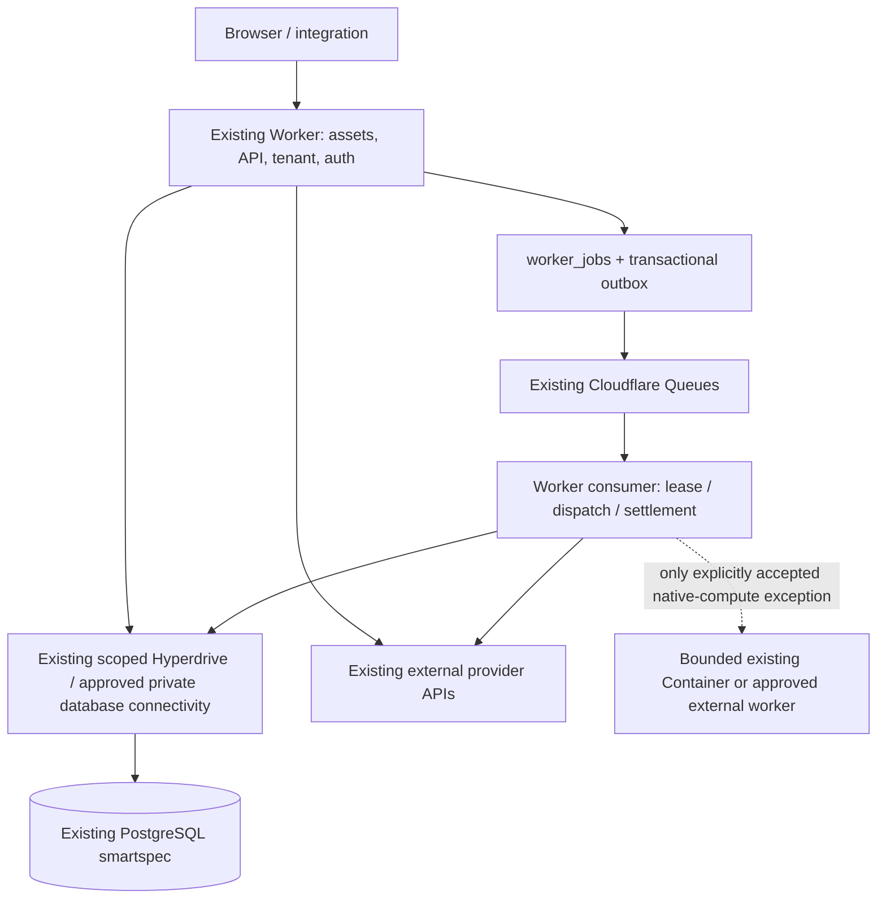

# SPEC-311 — SmartAIHub Worker Native Application and Cloudflare Queues Cutover

## Owner directive and scope

เจ้าของระบบกำหนดให้สร้าง spec ครอบคลุมการย้ายงานทั้งหมดไป Worker และ Cloudflare Queues ลดการใช้ Container และห้าม cutover จนกว่างานในขอบเขตจะย้ายครบและผ่านการทดสอบจริง การเพิ่มอายุ Container หรือให้ Worker proxy ไปยัง backend เดิมไม่ใช่ผลสำเร็จของ spec นี้

This is an application-runtime migration, not a database migration. PostgreSQL `smartspec` remains the database of record on its existing host. `aimarkethubs.com` remains Debian Development with its separate tenant in that database. Existing development administration access remains available.

“All work” means all active SmartAIHub application routes, procedures, browser flows, integration callbacks, scheduled tasks, and canonical job types established by the versioned inventory. There is no sampling-based completeness claim. Deprecated/prohibited systems are excluded, never restored to manufacture parity. Active features cannot be hidden, removed, disabled, or reclassified as retired to meet the gate.

Worker-incompatible native computation is a migration decision to resolve, not an implicit Container exception. Investigate Worker-compatible implementation, existing provider APIs, and approved direct external workers. Any irreducible Container requirement stays a cutover blocker until the owner explicitly accepts a named exception with measured bounds. This document grants no such exception, does not require Container-free physical third-party providers, and does not authorize substituting an unsupported agent runtime for the approved Python OpenAI Agents API boundary.

## Current implementation and evidence limits

Repository baseline inspected: `e9aa827c788acbb9967accc2b3f4b5616ed28d7b`.

- `apps/cloudflare/src/apiRouteManifest.ts` classifies auth, `/trpc`, `/api`, `/v1`, uploads and callbacks as retained-origin routes. Broad native API parity is not implemented.
- `apps/cloudflare/src/applicationHttpIngress.ts` forwards admitted Full HTTP application requests to Node HTTP Containers; `applicationHttpBridge.ts` bridges Node/Python. A Worker front door is not Worker-native execution.
- `apps/cloudflare/src/postgresClient.ts`, `hyperdrive.ts`, `queueConsumer.ts`, and `controlPlaneHandler.ts` already provide reusable foundations. Audit deployed bindings/receipts before extending them; source existence does not prove activation or end-to-end acceptance.
- Staging incident on 2026-11-01 demonstrated application auth 503 while Worker health was 200, followed by a successful auth GET after a new Container start. The browser auth bootstrap timeout is 10 seconds. The first Container readiness failure's underlying cause remains unproven; the stored credential's telemetry query returned 403. This is not evidence of bad passwords or a DNS propagation delay.
- Existing bounded application profiles enforce limited starts/compute and a per-start lifetime of at most 600 seconds. These are project policies, not universal Cloudflare Container platform limits. Do not remove genuine budget/security checks to pass tests.

Earlier protected-origin and Full HTTP Container plans remain valid historical implementation evidence but do not satisfy this spec's Worker-native cutover gate. SPEC-311 does not declare those entire specs superseded or rewrite their evidence.

## Target execution

Auth, ordinary page APIs, job intake/status/cancellation, Queue publication/consumption, and orchestration have no application Container dependency. Runtime state, sessions, and workflow progress cannot depend on a particular warm isolate. PostgreSQL remains authoritative; any additional storage uses existing approved boundaries and is not a second authority.

## Functional requirements

- **REQ-311-01 — Exhaustive inventory.** The implementation SHALL inventory all active HTTP methods/paths, tRPC procedures (including batches), browser flows, SSE/WebSocket endpoints, webhooks, cron tasks and registered canonical job types. Each entry records source/export, tenant/auth policy, dependencies, current runtime, target handler, migration state, test/evidence, and reason for any blocker. Dynamic registrations and runtime traces supplement source discovery. Unknown and newly added entries block completeness until reconciled.
- **REQ-311-02 — Runtime portability.** The application SHALL separate reusable domain services from Express request/response, server startup, process globals, local filesystem, child processes, native modules and unbounded timers. Worker handlers use Request/Response and explicit scoped bindings. A Fetch/tRPC adapter alone cannot close a route whose dependencies still call an application Container or Debian.
- **REQ-311-03 — Database continuity.** Worker handlers and consumers SHALL use the existing `smartspec` database through scoped supported drivers and reviewed Hyperdrive/private connectivity. Verify database identity, TLS, least-privilege application credentials, transactions, connection cleanup, tenant isolation and reviewed writes. Do not run schema creation/migrations/seeding on request, consumer or cold startup; do not embed administration credentials in runtime configuration. Authentication and mutable authorization reads cannot use stale query-cache results.
- **REQ-311-04 — Tenant and session parity.** Worker auth SHALL preserve existing user IDs, password hashes/algorithms, sessions/revocation semantics, tenant memberships, roles, cookies and authorization behavior. Resolve tenant from reviewed host mappings; reject spoofed forwarding headers and unknown hosts. Separate staging and production cookies. Cross-tenant reads/writes and batch-context leakage are forbidden.
- **REQ-311-05 — Complete authentication.** Worker-native login/logout, session/bootstrap/refresh/revocation where applicable, registration, invite/onboarding, email verification, forgot/reset password, OAuth callbacks and 2FA SHALL work with existing identities. Preserve TOTP encryption/decryption keys, recovery codes, pending challenges, lockout and rate limits; no automatic email verification, password reset, or 2FA disabling as migration shortcuts.
- **REQ-311-06 — Email delivery.** Verification/recovery/notification email SHALL use a demonstrated Worker-compatible transport and existing saved configuration where compatible, with idempotency, provider acceptance evidence, sanitized failures and controlled delivery tests. Verify inbox receipt for authorized test recipients. Preserve generic anti-enumeration responses; operator-only diagnostics distinguish rejection, retry, suppression and unknown receipt. A success screen does not prove delivery. No provider switch or additional credential system is assumed approved.
- **REQ-311-07 — Application API parity.** All active application capabilities SHALL migrate to native Worker handlers: dashboard/settings/admin, projects/Mini Apps/Runner-facing APIs, media/library/assets, vertical drama series/episodes/characters and editing flows, search/memory, credits/finance/payment integrations and relevant callbacks. Preserve validation, DTO/error/serialization semantics, authorization, pagination, transactions and tenant-scoped mutations. Refine this list from the inventory rather than treating examples as exhaustive.
- **REQ-311-08 — Chat, realtime and agents.** Chat/model access, tools and orchestration, streaming, reconnect, cancellation, provider callbacks, usage/credit settlement, SSE/WebSocket behavior SHALL migrate with bounded Worker-compatible execution and durable progress. Retain the approved OpenAI Agents API Python runtime boundary; prove compatibility rather than importing an entire unsupported backend or silently replacing that runtime. Any unresolved native dependency follows REQ-311-14 and blocks cutover.
- **REQ-311-09 — Assets and uploads.** Static assets, SPA navigation, authenticated downloads, signed/direct uploads and storage metadata SHALL use existing Worker/static-asset/object-storage boundaries, preserve authorization and storage references, and enforce content/size limits. Local disk and a warm application Container cannot be prerequisites for ordinary file operations. Payloads exceeding runtime limits use a proven existing storage handoff without weakening access controls.
- **REQ-311-10 — Transactional job intake.** Worker job intake SHALL atomically persist `worker_jobs` and its canonical outbox before publication to the existing Cloudflare Queue. Queue envelopes carry versioned job identity, tenant/project, attempt/dispatch references and integrity metadata needed by existing contracts, never copied secrets or large customer payloads. Publication failures leave recoverable outbox state. Reuse existing tables, contracts, credentials and publishers instead of creating a parallel job platform.
- **REQ-311-11 — Safe Queue consumption.** Worker consumers SHALL enforce existing tenant-scoped claim/lease/heartbeat/fencing and cancellation contracts. At-least-once delivery, non-ordered messages and crash boundaries cannot cause duplicate settlement or repeat external side effects; external idempotency keys/reconciliation are required where supported. Acknowledge only after durable terminal settlement or durable transfer of responsibility under an existing contract. Never promise globally exactly-once execution from Queue delivery alone.
- **REQ-311-12 — Full job coverage and recovery.** Every active canonical job type SHALL have a verified Worker-native executor or an explicitly resolved REQ-311-14 decision. Reuse existing retry/backoff, DLQ/quarantine, outbox sweep, expired-lease reconciliation, provider polling, scheduling and operator replay mechanisms; port required scheduling/control operations to Workers/Cron/Queues. Long jobs use durable bounded steps/provider async APIs, not detached promises. Poison messages cannot starve other tenants. DLQ retention/replay preserves identity, authority and attempt history.
- **REQ-311-13 — Shared-database execution ownership.** Queue migration SHALL enforce exactly one eligible executor ownership policy per target job scope across Cloudflare and Debian dev consumers sharing `smartspec`. Preserve separate tenant/environment authorization; drain or fence previously dispatched work and reject stale writers. A transport change cannot double-bill, rerun an accepted job, lose cancellation, or steal `aimarkethubs.com` development work. Rollback reconciles in-flight work instead of blindly republishing all rows.
- **REQ-311-14 — Container reduction and exceptions.** Normal HTTP/auth/data access and job-control/Queue paths SHALL operate with both application Node/Python Containers unavailable. For each native-compute dependency, record measured Worker incompatibility, migration alternatives, resource/cost/timeout limits, cancellation, isolation and artifact handling. Prefer migration to Worker or existing approved provider/external-worker execution. Any remaining Container execution requires an explicit owner-accepted named exception before cutover; absence of that decision remains BLOCKED, never automatic acceptance. Containers, if accepted, are per-job and cannot become a shared always-on web backend.
- **REQ-311-15 — Existing capabilities and disclosure.** Migration SHALL preserve active features, storage/provenance identities, source/artifact bindings and approved deployment IAM. Public branding uses SmartAIHub; customer-facing errors expose no secrets/internal paths. Retired systems stay prohibited. Do not revive them for route parity, introduce a new grant/approval system, or turn unrelated full SPEC closure/Neon/database relocation into migration prerequisites.
- **REQ-311-16 — Readiness and actionable UI.** Existing deployment readiness SHALL report assets/API/auth/database/Queue producer/consumer/executor/exception readiness separately, with human-readable reasons, last observation and next action. Profile refresh remains available when expiry/runway requires it. Missing prerequisites block the affected action server-side as well as in the UI. Worker liveness, a completed deploy job, source tests, or an aggregate green badge cannot imply application acceptance.
- **REQ-311-17 — Diagnostics and runtime attribution.** Protected telemetry SHALL bind request/job trace, source SHA, immutable config/deployment, handler runtime and scoped failure phase without exposing credentials or customer content. Verify effective existing credential permissions for needed logs. Public attribution headers alone are insufficient proof: combine provider traces, egress evidence and controlled backend-unavailability tests. Collect Container starts/runtime by workload and Worker CPU/request/Queue/retry costs with no invented savings targets.
- **REQ-311-18 — Staging fault and acceptance proof.** Staging SHALL pass exhaustive mapped API/job contracts plus real login/2FA/OAuth/session, email receipt, Chat/model streaming, existing-record reads, controlled tenant-scoped writes, uploads, webhooks, billing idempotency, and Queue recovery tests. Include cold isolates, duplicate/out-of-order deliveries, process death, database outage/recovery, provider timeout, expired credentials and no app-Container/Debian fallback. Run a minimum 24-hour supervised soak crossing former 10-minute Container lifetimes and six-hour staging-profile boundaries; ordinary Worker functionality cannot depend on renewing those Container profiles.
- **REQ-311-19 — Cutover interlock.** Production traffic SHALL remain unchanged until every active inventory entry is verified Worker-native or covered by an explicit REQ-311-14 acceptance, all requirement gaps affecting runtime behavior are closed, and Staging, backup/recovery, security, Queue in-flight reconciliation and tested rollback have fresh exact-release evidence. Unknown/unverified states block cutover. The existing server-side release path enforces this and emits the precise unsatisfied requirements; no new approval platform is added.
- **REQ-311-20 — Cutover and rollback proof.** An authorized cutover SHALL verify real `smartaihub.app` requests execute on the intended Cloudflare handlers without Debian application fallback, canonical PostgreSQL identity remains unchanged, and `aimarkethubs.com` retains its development runtime/tenant. Retain Debian as controlled rollback. Rehearse safe routing/version rollback with compatible sessions/schema and fenced in-flight Queue work; do not automatically replay mutations to a fallback origin. Runtime hosting and database hosting are reported separately.

## Delivery and acceptance boundaries

Use feature-scoped incremental development on canonical main. Implement native handlers beside existing adapters, compare contracts and enable only reviewed route/job scopes on Staging. No broad catch-all native claim, one-shot rewrite, or production activation during planning. Do not delete old rollback-capable code as part of this spec unless separately authorized.

Every inventory entry has one of: discovered, compatibility-proven, implemented, staging-verified, or blocked. Those labels are supporting evidence, not a second lifecycle engine. The canonical requirement handoff remains authoritative. A newly discovered active capability reopens its mapped coverage before acceptance.

Performance acceptance is established in section 01 from measured current behavior and provider/runtime limits. Baseline/regression thresholds and timeout budgets are frozen before porting; no unmeasured percentage reduction or arbitrary “all requests under N ms” claim. Security, no-dependency fault tests, and completeness are mandatory regardless of performance tuning.

## Sources and implementation anchors

Checked 2026-11-01; recheck runtime limits/compatibility at implementation time.

- [tRPC Fetch adapter](https://trpc.io/docs/server/adapters/fetch): Worker-compatible entry point; does not establish portability of router imports.
- [Cloudflare Hyperdrive](https://developers.cloudflare.com/hyperdrive/get-started/): existing database connectivity/pooling; reuse registered resources and approved network scope.
- [Cloudflare Queues delivery guarantees](https://developers.cloudflare.com/queues/reference/delivery-guarantees/): at-least-once delivery requires application idempotency.
- [Workers Node.js compatibility](https://developers.cloudflare.com/workers/runtime-apis/nodejs/): audit actual used APIs and pinned compatibility settings, not package names alone.
- Existing migration evidence: `orchestra/tasks/cloudflare-delegated-staging-20261017/HANDOFF.md` and `origin-completion/` supporting plans.

## Next development action

Start section 01: complete route/procedure/job dependency inventory and demonstrate a minimal real Worker-to-canonical-PostgreSQL request with no app Container or Debian application call. Then implement auth/email and Queue delivery/consumption as independently testable slices. This spec is planned; application parity, production deployment and cutover are not claimed complete.
