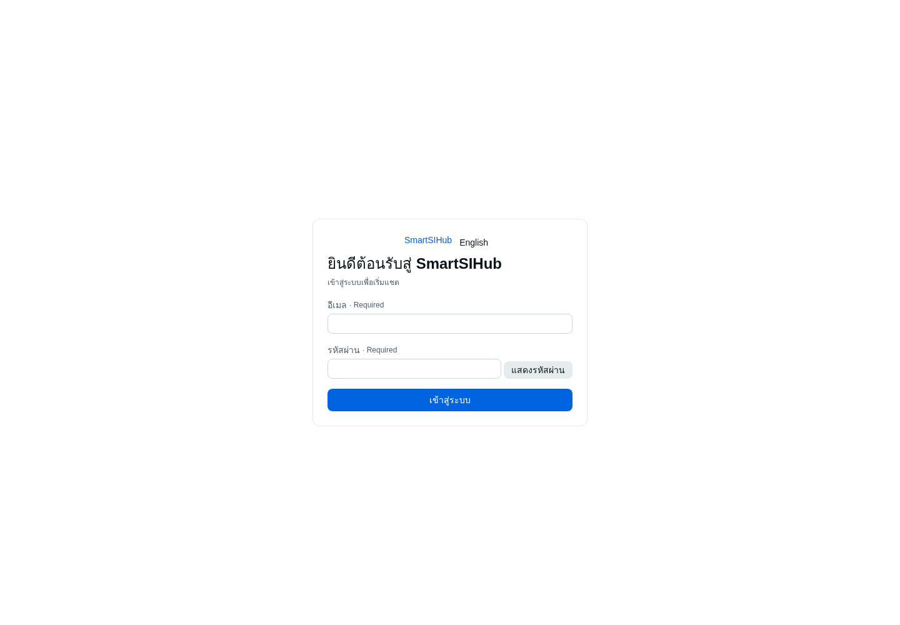

# Modular development domain handover — 2026-11-10

## Result

`https://aimarkethubs.com` now serves the Modular Shell. Visiting `/` loads the new Shell and routes an anonymous user to its login page; after authentication the Shell opens `/chat`. The legacy dashboard is no longer the application served on this hostname.

This is the `modular-debian-dev` development target only. `smartaihub.app` remains on its Legacy Debian service, and `smartsihub.com` remains inactive.

## Release identity

- Target: `modular-debian-dev`
- Domain: `aimarkethubs.com`
- Runtime: Debian with three independent local Workerd services
- Platform source SHA: `660867d205bcbc4ec52e0387ba9626b6cb23d06e`
- SmartSpecPro release-controller SHA: `24846beb25784ba98040b1db991b0d530b642abb`
- Release: `/home/dev/modular-development-releases/660867d205bcbc4ec52e0387ba9626b6cb23d06e`
- Release receipt: `/home/dev/modular-development-releases/660867d205bcbc4ec52e0387ba9626b6cb23d06e/release-manifest.json`
- Database: existing shared `smartspec`; a read-only connection probe verified `modular_core_auth_dev`

The Core, Chat, and Shell were built independently with `pnpm run build:core`, `pnpm run build:chat`, and `pnpm run build:shell`. Each Wrangler dry-run passed. No aggregate Legacy build ran and no Cloudflare Worker was deployed.

## Routes and services

| Surface | Service | Port | Public route |
| --- | --- | ---: | --- |
| Core / Hono auth | `smartsihub-core-dev.service` | 3200 | `/v1/core/*` |
| Chat API and module assets | `smartsihub-chat-dev.service` | 3201 | `/api/chat/*`, `/modules/chat/*` |
| Shell / login and Chat host | `smartsihub-shell-dev.service` | 3202 | remaining paths |

All three services are enabled as user services. The aimarket Tunnel waits for them at startup. The new Core allows the development hostname for its local target, and Chat calls Core through the Worker Service Binding using the same HTTPS host bound to the session.

## Verification

- Focused Core tests: 32 passed; Core typecheck passed.
- Focused Chat tests: 12 passed; Chat typecheck passed.
- Release-controller policy tests: 4 passed.
- Local Workerd smoke: Core, Chat, and Shell returned 200; Chat without a session returned 401; Chat manifest and entry asset returned 200.
- Public smoke after Tunnel restart: `/`, `/login`, Chat health, and Chat module manifest returned 200; Chat session without a cookie returned 401.
- Public root HTML contains the new Shell asset links and no legacy dashboard marker.
- A Chromium screenshot of the public root shows the SmartAIHub sign-in screen with Thai/English controls, email/password fields and the sign-in action; no legacy dashboard is rendered. Temporary screenshot: `/tmp/aimarket-ui-verified.png`.
- The original `smartspec-dev-web.service` remains active on port 3100 as rollback.

The deployment proves route, assets, host/session configuration and shared database connectivity. Interactive login with an existing user's password was not exercised, and no account was created or reset. The user can now inspect the real login screen at the domain and continue into `/chat` with the existing SmartAIHub account.

Chat persistence and model-provider configuration remain separate product gaps; the deployed UI reports their configured state rather than claiming those capabilities are live.

## Subsequent Login UI release — 2026-11-10

The current `modular-debian-dev` release supersedes the initial Shell screenshot and branding above. The development hostname remains `aimarkethubs.com`; `smartsihub.com` remains inactive.

- Platform source SHA: `5148814925accf6ed7ec46dd11465ed11e30da1f`
- Release: `/home/dev/modular-development-releases/5148814925accf6ed7ec46dd11465ed11e30da1f-brand-update`
- Release receipt: `/home/dev/modular-development-releases/5148814925accf6ed7ec46dd11465ed11e30da1f-brand-update/release-manifest.json`
- Visible product branding is `SmartSIHub` on Login, Shell Chat header, service status, and Chat module title; the Chat message timeline's assistant label uses the same brand.
- Login has a Thai/English “แสดงรหัสผ่าน / ซ่อนรหัสผ่าน” (`Show password / Hide password`) secondary button beside the password field. Visibility is transient component state; the password is not persisted and is cleared when MFA is required.
- Core, Shell, and Chat package builds plus Wrangler dry-runs passed on the exact integrated source revision.
- Release-controller local smoke passed for Core, Chat, and Shell (200); unauthenticated Chat session remained 401; Chat manifest and entry asset returned 200.
- Release-controller public smoke passed for `/`, `/login`, Chat health, and Chat module manifest (200); unauthenticated Chat session remained 401.
- All three service units now point to this same immutable release. The public Chat module HTML title also returns `SmartSIHub Chat`.
- Automated UI/unit tests were not run for this follow-up. No user was created and no password was changed; interactive login was not exercised.

Public Login screenshot from the current release:



## Rollback

The prior ingress configuration is preserved at:

`/home/dev/modular-development-releases/660867d205bcbc4ec52e0387ba9626b6cb23d06e/rollback/cloudflared.pre-modular.yml`

To restore the prior aimarket route while leaving the new services available for diagnosis:

```bash
cp /home/dev/modular-development-releases/660867d205bcbc4ec52e0387ba9626b6cb23d06e/rollback/cloudflared.pre-modular.yml /home/dev/.config/smartspec-dev/cloudflared.yml
systemctl --user restart smartspec-dev-tunnel.service
```
