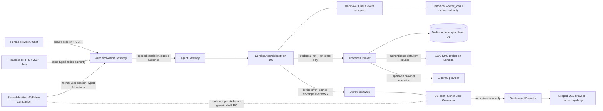

# SPEC-325 — SmartAIHub Zero-Trust & Always-on Agent Security Architecture

> **Current-revision note (R1.5, 2026-11-02):** This proposed security architecture controls new-platform cross-SPEC security requirements where explicitly cited; it does not claim implementation, deployment, enrollment, account provisioning or production readiness. Existing frozen owners and Legacy-specific contracts remain in their stated scope.


**Status language:** This document specifies a proposed architecture. It is not implementation, account provisioning, security certification, enrollment proof, deployment evidence or a claim that production resources exist.

## 0. Authority, compatibility and scope

This is the cross-cutting security contract for the new SmartAIHub Modular SaaS platform. It covers the new smartsihub.com product and its isolated development/preview environments. It does not require a full cutover of the still-operating smartaihub.app Legacy site, change DNS or Cloudflare resources, migrate real data, or change services on the current Debian site.

The current target registry reports aimarkethubs.com as a prepared, unavailable modular development target and smartsihub.com as registered but not activated. Those entries are not runtime evidence. New platform implementation MUST verify the target, identity, DB, Worker bindings and authorization before any release.

This SPEC adds security adapters without rewriting frozen authorities:

| Existing authority | Contract retained by this design |
|---|---|
| SPEC-207, specs/feature/207-agentic-economic-control-plane/spec.md | Existing wallet, spending authorization, ledger, reserve/capture/release, settlement and reconciliation authority. This file does not declare a separate ledger. |
| SPEC-208, specs/feature/208-hybrid-computer-use-dynamic-capability-routing/spec.md | Existing Computer Use policy, eligible-route decision and desktop execution contracts. This SPEC adds device trust controls. |
| SPEC-224, specs/feature/224-Autonomous Development Orchestrator Runtime/spec.md | Existing development Goal/Run/source/executor authority and its recovery controls. |
| SPEC-256, specs/feature/256-skill-first-capability-discovery-intent-execution/spec.md | Capability discovery and selection do not grant execution authority. |
| SPEC-267, specs/feature/267-smartaihub-cloudflare-production-migration-durable-execution-control-plane-v2/spec.md | Applies to its existing Legacy migration authority. This new product is not a hidden SPEC-267 cutover or requirement to restore removed infrastructure. |
| SPEC-272 v1.1, specs/feature/272-smartaihub-credential-vault-root-of-trust-secure-provider-broker/spec.md | Credential references, use-without-disclosure, provider-bound calls, application-level encryption, redacted audit and deny-by-default broker contract remain. For this new platform only, this R1.5 decision changes the root-key placement: Cloudflare Secrets Store is Tier B for selected shared service credentials, not the Tier C tenant-vault KEK. The new platform uses the external AWS KMS key service and broker defined here. This is a deployment-profile adapter; it does not retroactively alter SPEC-272 consumers or data. |
| SPEC-273, specs/feature/273-portable-mini-app-data-architecture/spec.md, and SPEC-261, specs/feature/261-smartaihub-portable-ai-application-standard-v1-6-0/spec.md | App data plane and portable package boundaries remain separate from Core authority. |
| SPEC-280, specs/feature/280-metered-capability-commerce-creator-economy-runtime-r1-0/spec.md, SPEC-303, specs/feature/303-smartaihub-ecosystem-asset-registry-ownership-transfer-distribution-discover/spec.md, SPEC-321 and SPEC-322 | Pricing, rights, credit denomination and agent spending contracts remain owned by their existing authorities. |
| SPEC-287, specs/feature/287-Unified-UI-Governance-Rendering-Conformance-MiniApp-Design-Contract/spec.md | Shared UI/action rendering must satisfy the existing UI governance contract. |
| SPEC-295, specs/feature/295-SmartAIHub-Production-Release-Deployment-Runtime-Data-Migration-Operations/spec.md | Release and rollback authority remains with the existing deployment owner. |
| SPEC-304, specs/feature/304-smartaihub-application-identity-universal-routing-managed-hosting-deployment/spec.md | App identity and route resolution remain canonical. |
| SPEC-309 | No canonical spec.md was found under the configured roots at this baseline; no contract is inferred from the number. SPEC-310 remains at specs/feature/310-smartaihub-native-agent-harness-governed-pi-runtime-lifecycle/spec.md and is referenced only as an existing draft/proposal where applicable. |
| SPEC-311, specs/feature/311-smartaihub-worker-native-application-and-queues-cutover/spec.md | Applies to the existing Legacy application cutover scope. It is not a prerequisite for the separate new smartsihub.com product. |

For the new platform, each environment MUST have one canonical authority for identity, entitlement, financial settlement and job lifecycle. Cloudflare Agents/DO state, Workflows, Queues, device journals and Mini Apps may project or transport this authority but MUST NOT create a duplicate ledger, settlement service, entitlement authority or job ledger. New production and development require separate database identities, DB roles, credentials and encryption-key boundaries from Legacy. No data migration or database sharing is implied.

## 1. Security invariants

1. Verify each human, tenant, service, agent, module and device principal for every requested action. Resolve tenant membership server-side; never accept caller-supplied tenantId as authority.
2. Authorize the narrowest capability for one audience, environment, resource, action and bounded time. No agent, module or Runner can grant itself authority or enlarge its own scope.
3. A Service Binding is a private route, not an authorization token. A Cloudflare Access identity is not automatically propagated through a Service Binding and is not a replacement for application user authentication.
4. Bind consequential actions to a current policy epoch, consent/Goal grant, effect digest, idempotency key, audience and expiry. Recheck policy and revocation before secret resolution and before external effect.
5. Keep reusable provider credentials inside the Credential Broker. Agents, prompts, tool outputs, Mini Apps, browser profiles, queues, memory, notifications, telemetry and receipts receive no credential plaintext.
6. Treat external webpages, messages, files, skills, model output, imported listings and device output as untrusted data. Provenance is retained; content cannot directly rewrite system policy or authorize effects.
7. Prefer Cloudflare-native event-driven durable services for cloud identity and recovery. Do not equate a Durable Object, Agent SDK instance, Queue consumer or Workflow with a process that remains resident.
8. Keep the device Core Connector and workload Executor separate. The Core Connector reconnects automatically from OS boot while enrolled and authorized. The Executor is launched only for a permitted task.
9. Distinguish ONLINE_CORE_ONLY, ONLINE_EXECUTOR_READY, WAITING_FOR_EXECUTOR, WAITING_FOR_INTERACTIVE_SESSION, PAUSED, REVOKED, OFFLINE and QUARANTINED. Never report unverified capability as online or running.
10. Preserve accessibility, privacy and user controls. Pause, disable, unpair and remote revoke are real controls. A model response or UI toggle cannot forge their state.

## 2. Data-flow and trust boundaries



### Trust-boundary contracts

| Boundary | Trust rule | Required evidence |
|---|---|---|
| Public Internet to Auth/Action Gateway | TLS, origin/session checks, CSRF for browser writes, rate limits, typed schema and server-derived tenant | Unauthenticated, cross-origin, forged tenant and replay tests deny. |
| User session to Agent goal | User session may create a bounded Goal grant only within own tenant and membership. Grant is server-issued and revocable. | Invalid membership, stale session epoch and out-of-scope action tests deny. |
| Worker to Service Binding | Binding narrows routing. Target authenticates a signed short-lived service assertion with issuer, audience, scope, tenant and policy epoch. Access context is not propagated. | Confused-deputy and wrong-audience binding tests deny. |
| Agent to Workflow/Queue/job authority | Transport carries IDs, version, effect digest, grant reference and non-secret metadata only. Canonical job admission/outbox/lease remains authoritative. | Duplicate delivery, lost ACK and stale lease tests produce one business effect. |
| Credential Broker to Vault | Broker alone reads ciphertext binding and requests data-key operations. Main application Worker and other modules have neither Vault D1 nor KMS broker authority. | Deployment binding audit and cross-worker call tests. |
| Cloud to device | TLS/WSS plus device-key proof of possession for enrollment, renewal and each effect-bearing envelope. Optional edge mTLS is defense in depth only. | Invalid certificate/TLS, signature, nonce, audience, policy epoch, revoked device and replay tests deny. |
| Device Core to Executor | OS-authenticated local IPC with a method allowlist. The Executor gets only the job-scoped file/process/browser permissions. | Other OS user, compromised UI and generic command invocation tests deny. |
| WebView to native shell | Only pinned SmartAIHub HTTPS origin and versioned allowlisted IPC. No device key, raw provider key, generic execute(command), arbitrary remote website navigation or direct local admin route. | XSS, unknown Origin, stale UI version and forged IPC tests deny. |
| Mini App / BYOC to Core | App identity and owner-bound grants are explicit and revocable. Core credentials are never embedded or inherited. | Forged App, cross-App and revoked BYOC grant tests deny. |

### Data classification

| Class | Examples | Storage and handling |
|---|---|---|
| Public | Public listing, published portfolio, public documentation | Public delivery only after visibility policy; still escape and provenance-tag imported text. |
| Tenant | Chat content, project metadata, non-secret artifacts, schedules | Tenant-scoped Core storage, strict access checks, retention/export/delete contract. |
| Restricted financial | Wallet IDs, mandates, quotes, ledger/job settlement references | Existing financial authority only; use opaque references in UI/event projections; preserve immutable audit evidence. |
| Secret material | BYOK provider keys, OAuth refresh tokens, KMS broker authorization, signing keys | Tier A/B/C placement matrix below; no plaintext in database, queue, prompt, log, memory, browser local storage or receipt. |
| Device secret | Private proof-of-possession key, renewal key | OS-protected local keystore/TPM where available. Public key/thumbprint and device policy metadata only on server. |
| Security evidence | Signed receipts, policy epochs, key IDs, action hashes, non-secret audit fields | Access-restricted immutable audit store with defined retention and privacy minimization. |

## 3. Threat model (STRIDE-style)

| Threat | Example attack | Required mitigations | Required denial/evidence |
|---|---|---|---|
| Spoofing | Stolen browser cookie reused as a Runner; forged tenantId; cloned device key | Separate principals; secure user sessions; device PoP; audience-bound short-lived grants; protected keystore; revocation epoch | Wrong principal/tenant/device receives DENY and redacted security event. |
| Tampering | Queue payload or action effect changed after authorization | Signed envelopes, canonical serialization, effect digest, schema version, lease fencing and idempotency key | Digest/signature mismatch cannot dispatch or settle. |
| Repudiation | Agent or user disputes a purchase, publish or file effect | Append-only actor, grant, goal/run, provider receipt and policy epoch record; signed device receipt | Audit can reconstruct authorization without recording secret values or full prompts by default. |
| Information disclosure | BYOK leaks through prompt, vector search, screenshot, notification, trace or stolen D1 dump | Tiered vault, application-layer AEAD, broker-mediated provider calls, data minimization/redaction, strict RAG ACL and origin isolation | Secret canaries never appear in output, logs, queues, memory, exports or browser state. |
| Denial of service | Queue flood, reconnect storm, malicious retry or expensive model goal | Per-tenant budgets, concurrency/rate caps, bounded payloads, jittered reconnect, backpressure, retry ceilings and dead-letter quarantine | One tenant cannot exhaust shared capacity; job remains truthful WAITING/THROTTLED. |
| Elevation of privilege | Prompt injection asks Agent to self-grant, a Service Binding caller invokes admin RPC, WebView XSS calls shell | Deterministic policy before model choice; independent downstream auth; narrow typed actions/IPC; no self-grant; step-up by impact | Deny forged capability, unknown method, unapproved origin or effect mismatch. |
| Cross-tenant confusion | Reuse of a grant, credential ciphertext or memory pointer across tenants | Tenant-derived lookup, AEAD AAD binding, caller/run checks, no wildcard plaintext API, tenant-bound vector namespace and DB roles | Forged tenantId, copied ciphertext and stale grant fail closed. |
| Endpoint compromise | Malware reads user files/browser profile or swaps signed update | Low-privilege service identity, code-signed packages, anti-downgrade, scoped Executor, no browser cookie access, signed updates and quarantine | Invalid binary/update cannot execute; remote revoke blocks next effect. |
| Supply-chain compromise | Malicious package/skill/CI token alters Worker code or binding | Lockfiles, SBOM/provenance, dependency review, least-privilege deploy identities, release trace and isolated production path | Untrusted artifact cannot add bindings or deploy to another target. |

### Named attacker classes and residual exposure

| Attacker | Required control and detection | Residual impact boundary |
|---|---|---|
| On-path observer, DNS attacker or rogue network | TLS 1.3 with hostname and chain validation, no insecure fallback, device proof on every session and signed effect envelope; alert on certificate/key changes. | TLS terminates at Cloudflare Edge; network protection does not hide payload from an authorized Edge/runtime. |
| Stolen bootstrap/service token or WebSocket bearer | Short TTL, narrow audience, no query-string token, fresh device-key proof, nonce replay cache and epoch revoke. | A still-valid stolen token may expose limited metadata until expiry; it cannot authorize a device effect without proof and current grant. |
| Stolen laptop, cloned device or malicious local process | TPM/OS key store where supported, device posture/version, local ACL and quarantine; never represent signing non-exportability as malware immunity. | Malware able to invoke an unlocked device key can request signatures until revoke or quarantine reaches it. |
| Confused-deputy Worker or cross-tenant caller | Verify issuer/audience/tenant/app/run/scope at every binding and broker boundary; never trust payload tenantId. | A compromised authorized Worker can still exercise its own bounded permissions. |
| Compromised Runner user session or endpoint | Separate Connector and Executor OS identities, scoped workspace roots, no personal browser cookie, allowlisted IPC, signed updates and remote revoke. | Endpoint compromise can read data already accessible to the running task; revoke cannot instantly control a disconnected machine. |
| Malicious skill, prompt, email, browser page, file or marketplace listing | Provenance labels, schema-constrained actions, deterministic policy, credential isolation, output filtering and egress controls. | The model can still produce incorrect safe-scope work; grants, effect checks and budgets limit impact. |
| Update-channel compromise, CI insider or cloud-account operator | Artifact digest/signature, publisher/version allowlist, anti-downgrade, least-privilege release role, two-person key changes and audit. | A compromised signing root or account may replace trusted components; isolate and rotate the affected trust root. |
| Offline/partitioned device or stale authorization | Short-lived lease/grant, policy epoch, bounded offline policy and server reconciliation before consequential effects. | Immediate remote stop is impossible until connectivity returns; already-started local effects may need reconciliation. |
| Wrong-target operator or production credential leak | Exact target assertion, separate prod identity, artifact provenance and fail-closed resource checks. | A valid production identity remains high impact; it requires its separate release and incident controls. |

## 4. Principal, membership and grant model

| Principal | Identity source | Permitted authority | Prohibited authority |
|---|---|---|---|
| Human user/operator | New platform identity service; passkey/WebAuthn and MFA where available | Actions allowed by current tenant membership, session, role and explicit grant | Cloudflare account membership alone is not a customer tenant role. |
| Tenant/workspace | Canonical new platform tenant record | Namespace and policy scope; cannot authenticate by itself | TenantId supplied in request is never proof of membership. |
| Agent | Server-created durable Agent ID bound to tenant and owner/Goal | Actions in one valid Goal grant, budget, audience and policy epoch | Cannot self-enroll, self-grant, change owner or expand its capability. |
| Service/Worker | Isolated per-Worker runtime identity | Narrow service operation and explicit target audience | Service Binding presence does not authorize the requested action. |
| Module/Mini App | Registry identity, owner and signed manifest | App-scoped routes, data bindings and granted Core actions | No Core DB, Vault D1, account master key or implicit tenant-wide access. |
| Runner device | One-time enrolled device ID and private proof-of-possession key | Only signed, leased capabilities for paired tenant/device and permitted user/session mode | Device identity does not imply user session, administrator or unattended GUI authority. |
| External provider | Configured provider manifest and credential grant | Specific provider endpoint, operation, amount and effect | Provider response cannot grant new platform authority or alter policy. |

Every capability grant includes: grantId, grantVersion, issuerPrincipal, subjectPrincipal, tenantId, audience, resourceId/appId, allowedActions, dataClass, goalId/runId where relevant, budget/limits, issuedAt, expiresAt, policyEpoch, consentReference, revocation handle and nonce or idempotency scope. The verifier derives tenant membership from trusted identity state, checks expiry and policy epoch, and records a redacted decision receipt.

Policy epochs increase on membership changes, credential or device revoke, account recovery, grant scope change, security hold and key compromise. Old signatures remain cryptographically valid but are rejected when bound to a stale epoch.

### Authentication and step-up

- Human sessions use secure short-lived access and refresh lifecycles, server-side revocation, Secure/HttpOnly/SameSite cookie settings, CSRF tokens for state-changing browser requests, request-origin validation and account recovery that does not bypass MFA silently.
- Support passkeys/WebAuthn and MFA as the new platform's phishing-resistant authentication path; retain an audited recovery path with notification and session invalidation.
- A browser session is never used as the device's long-lived credential. Device renewal uses its own private key and current server grant.
- Step-up is based on effect impact and applicable account policy, not on whether an Agent asks. Examples include money above mandate, destructive data, external purchase, public publishing, credential delegation or device re-enrollment.
- A single bounded Goal grant covers ordinary in-scope steps. Safe retries, scheduled wakeups, token renewal and device reconnect do not prompt repeatedly. User interaction is required only for a genuine policy escalation, expired high-impact approval, new device, recovery or revocation event.

## 5. Three-tier credential architecture — normative

Tier A, Tier B and Tier C have separate owners and trust boundaries. The binding example and source-of-truth matrix below are normative. A cloud provider's at-rest encryption does not replace application-side encryption for BYOK.

### Tier A — per-Worker Platform Keys

Use Cloudflare Workers Secret bindings for Worker-specific platform secrets, bootstrap keys and signing material. Scope each key to one Worker and environment. Use non-secret resource bindings for D1/R2/Hyperdrive/Service Bindings instead of inventing API keys.

Every applicable Worker declares required secret names with Wrangler secrets.required. Wrangler deploy and versions upload must reject missing required values. Because current local dev validation only warns, the application startup/readiness check must independently fail closed if required configuration is absent, malformed or uses a disabled key version.

Never store secret values in plaintext vars, source, logs, queue payload, example values, checked-in .env or .dev.vars. Separate Cloudflare accounts and deployment identities for development, preview/staging and production. No one all-powerful key is injected into every module. Maintain named owners, consumer map, rotation/version transition, emergency revocation and break-glass recovery.

### Tier B — selected Cloudflare Secrets Store credentials

Use Cloudflare Secrets Store only for a small number of approved cross-Worker service credentials when a native binding or workload identity is not available. Bind an individual named secret only to an approved Worker or AI Gateway integration and grant the narrow scope needed. Do not use this store as the per-tenant BYOK database or assume every Worker can access every item.

Official Cloudflare documentation checked 2026-11-02 identifies Secrets Store as open beta, currently compatible with Workers and AI Gateway, and documents one store and up to 100 secrets per account. Access requires both a caller role/token with binding permission and a compatible per-secret service scope; current scopes include workers and ai-gateway. A Secrets Store Reader cannot bind a secret. Recheck current plan, account rollout, product status, limits, CI binding permissions and local support before implementation. If unsuitable, keep a credential local to its approved Worker as Tier A or use the selected external vault/KMS broker; never silently put per-tenant credentials in the Store.

### Tier C — platform-owned encrypted tenant credential vault

The new platform owns a logical Credential Vault and Secure Provider Broker. For this deployment profile, store ciphertext and necessary non-secret metadata in a dedicated Cloudflare D1 database per environment. Encrypt the user-provided value in the Vault Worker before persistence using AES-256-GCM, with a fresh 256-bit per-record-version DEK and unique 96-bit nonce. Bind authenticated additional data to environmentId, tenantId, appId, credentialId, ownerPrincipalId, providerId, credentialVersion and cipherVersion. Wrap the DEK with AWS KMS-backed envelope encryption. The AWS KMS key is a customer-managed symmetric key held in a separate security account; it is not a Cloudflare feature.

AWS KMS operations run behind a narrowly scoped AWS API Gateway endpoint and a small credential-kms-bridge Lambda. The Lambda's AWS execution role can invoke only GenerateDataKey, Decrypt and ReEncrypt on the named environment KEK ARN; it has no access to Vault D1 or provider BYOK. The Vault Worker calls the bridge with a short-lived, audience-bound signed request using a per-Worker Tier A signing secret. The bridge validates Worker identity, environment, request nonce, tenant/app/credential context and allowed operation before calling KMS. No long-lived AWS access key is placed in a Worker, source file, queue or D1. The bridge returns a plaintext DEK only over authenticated TLS for immediate in-memory use, plus the wrapped DEK. Worker logs and traces omit both values. This cross-cloud path is a proposed design and must be provisioned/tested before use; until then, Tier C writes and reads fail closed.

The AWS KMS EncryptionContext binds environment, tenant, app, credential and cipher version. The Credential Broker independently checks principal, grant, purpose, run, budget, consent and current policy before requesting unwrap and checks policy again before the provider effect. This prevents the model, Agent, Skill, Mini App, browser or Executor from receiving long-lived raw BYOK. If a provider requires a direct call, only a provider-supported short-lived scoped token may leave the Broker; otherwise the exception needs an explicit provider and effect security design.

Routine KEK rotation creates a new environment key, switches writes to it, uses KMS ReEncrypt to rewrap stored DEKs, verifies active rows and retained backups, and preserves the prior KEK until recovery evidence and retention permit retirement. AWS KMS rotation of key material does not itself re-encrypt external data keys. Suspected compromise requires immediate credential-use hold as scoped, a new KEK/DEKs, re-encryption of active values and revocation/rotation at the external provider where supported. The KMS account is protected by phishing-resistant MFA, two-person key administration, CloudTrail audit, deletion protection and a tested restore/failover plan. Key deletion is prohibited while any live row or retained backup needs it.

### Cloudflare binding example — names and types only

The example names no real secret values, account IDs or resource identifiers. Replace resource identifiers only in a separately reviewed environment deployment configuration.

```json
{
  "name": "credential-vault",
  "secrets": {
    "required": ["VAULT_SESSION_SIGNER", "DEVICE_GRANT_SIGNER", "KMS_BRIDGE_SIGNER"]
  },
  "d1_databases": [
    {
      "binding": "VAULT_CIPHERTEXT_DB",
      "database_name": "credential-vault-production",
      "database_id": "<environment-owned D1 identifier>"
    }
  ],
  "secrets_store_secrets": [
    {
      "binding": "SHARED_BILLING_PROVIDER",
      "store_id": "<approved account Secrets Store identifier>",
      "secret_name": "billing-provider-production"
    }
  ]
}
```

The Secrets Store binding above is an optional Tier B example. The D1 binding holds only Tier C ciphertext and metadata. The KMS bridge authorization signer is a Tier A Worker secret; the AWS KMS KEK and Lambda execution role are outside Cloudflare. No key value is shown.

## 6. Credential placement matrix

| Credential type | Authority and target | Owner | Permitted readers/actions | Retention and rotation | Failure mode |
|---|---|---|---|---|---|
| Worker session/action/device signing key | Tier A Worker Secret, per Worker and environment | Platform security operations | Only named Worker; sign the named audience/contract | Versioned overlap and rotation; revoke old key/policy epoch | Startup/readiness fails closed; affected session/action path unavailable. |
| Database or provider credentials required by one Worker | Tier A Worker Secret; native binding preferred when available | Service owner and platform security | Only bound Worker and exact database/provider operations | Rotate per environment; never share all-powerful DB admin credential | Refuse DB/provider operation and alert; never fall back to plaintext vars. |
| Selected cross-Worker billing/telemetry credential | Tier B Secrets Store binding scoped to Workers or AI Gateway | Platform credential owner | Only named approved consumers and operations | Recheck 1-store/100-secret beta limit; owner-reviewed rotate, replace, revoke | Fall back to Worker-local Tier A or pause that integration; no Tier C use. |
| User/tenant BYOK API key, OAuth refresh/client secret | Tier C encrypted credential Vault D1 + AWS KMS-wrapped DEK | Verified user/tenant/App owner | Credential Broker only; provider-bound operations; no general read endpoint | Versioned replacement, dual-key overlap where safe, provider revoke, expiry, tenant export/delete under retention policy | Deny use if grant, key, KMS or policy is unavailable. |
| KMS KEK and AWS authority | AWS KMS customer-managed key; Lambda execution role; Worker signs scoped request to broker | Separate security account administrators | Lambda role performs only data-key cryptographic operations; no generic AWS admin | Two-person grant changes; key rotation/re-encryption; no deletion while ciphertext/backups need it | Tier C fails closed; queued use may wait; no plaintext alternate. |
| Device proof-of-possession private key | Windows TPM/OS-protected key store or Linux protected key store/TPM where available | Device owner/admin and paired user | Core Connector signs only enrollment/renewal/device envelopes; private key never exported | Key rotation via signed re-enrollment; remote revoke; lost device quarantined | Device becomes REVOKED/QUARANTINED and cannot silently pair again. |
| Human web session / refresh state | New platform session service and browser secure cookie | Human user | Auth service, browser cookie jar; UI sees only normal session state | Short expiry, rotation, logout and policy-epoch invalidation | UI re-authenticates; device service remains independently governed. |
| BYOC deployment token or customer credential | Customer-owned secret manager or short-lived scoped federation | App owner/customer admin | Named App deployer and target account only | Owner-controlled rotate/revoke; do not copy into Core master secret | BYOC release pauses; no fallback to Core-owned wildcard token. |
| Queue/Workflow/job message | Not a credential store; IDs and non-secret signed metadata only | Canonical job authority | Authorized transport consumer | Retain by job/audit policy; no secret rotation because secrets are forbidden here | Invalid, stale or oversized payload is quarantined and redacted. |

### Credential record model and API contract

The dedicated Vault D1 record stores only ciphertext and non-secret lifecycle metadata:

- credentialId (opaque random ID), environmentId, tenantId, appId, providerId, ownerPrincipalId and credentialType;
- purpose, approved provider manifest, grant metadata/references, allowed capability and optional run scope;
- cipherVersion, algorithm, nonce, ciphertext, wrappedDEK, keyProvider=AWS_KMS, kekArn/keyId and KMS EncryptionContext version;
- createdAt, updatedAt, expiresAt, revokedAt, rotation state and audit reference.

The database MUST NOT contain provider plaintext, plaintext DEK, raw OAuth refresh token, API Authorization header or a reusable broker token. Credentials are append-versioned. Changing a tenant, App, provider origin or AAD-bound owner creates a new version/rebind rather than mutating the ciphertext identity in place.

Public APIs are typed and expose no plaintext-read operation:

- POST /v1/credentials — authenticated secure ingestion; validate owner, tenant, provider and purpose; return credentialRef and masked non-secret metadata.
- POST /v1/credentials/{credentialId}/validate — Broker-only provider validation with redacted result.
- POST /v1/credential-operations — Broker-only, typed provider operation; requires credentialRef, operationId, payload schema, grantId, goalId/runId, budget receipt, effect digest and idempotency key.
- POST /v1/credentials/{credentialId}/rotate — secure replacement/re-encryption workflow; return rotation receipt, never previous or next secret.
- POST /v1/credentials/{credentialId}/revoke — immediately increment policy/grant epoch, deny future use and enqueue provider-side revocation where supported.
- GET /v1/credentials/{credentialId} — owner-authorized metadata only; never returns ciphertext or secret material.

Before any provider operation, the Broker resolves the tenant from a verified issuer/session or server-owned run grant, checks owner/App/principal/capability/run/budget/consent/epoch/provider destination, resolves the credential, and checks expiry/revocation. Immediately before the external effect it repeats grant/epoch/effect checks. It records a redacted receipt containing identities, provider, operation, decision, timing, amount reference, response class and idempotency result, never the secret or default full request/response body.

### Rotation, revocation, deletion and recovery

1. Ingestion is over TLS with authenticated owner and fresh CSRF/step-up where policy requires; values are never written to logs, exception text, prompt context or analytics.
2. Provider validation uses an allowlisted origin and operation. Redirects, DNS/private-IP rebinding, proxy override and arbitrary URL input cannot carry credentials.
3. Replacement first validates the new value, then activates a version with a bounded overlap policy. Revoke old provider token where supported; stale grants are denied.
4. Revoke increments credential and tenant policy epochs immediately, cancels queued operations not yet dispatched, and prevents scheduled Agent work from using the old grant.
5. Rotation of the KEK and rotation of the provider credential are separate operations. KMS rewrap does not make an exposed third-party token safe again.
6. Tenant export returns owner-authorized metadata and, only where policy/legal contract allows, a secure re-entry or provider-native transfer path. It never exports decrypted secrets by default.
7. Tenant deletion disables use first, records a non-secret tombstone outside the Vault backup boundary, deletes live credential rows, revokes provider grants where possible and ages out ciphertext snapshots according to the declared retention schedule. Restore tooling reapplies tombstones before reopening Broker traffic.
8. Restore uses encrypted D1 snapshots and the correct retained KMS keys. Validate MAC/digest, AAD, tenant isolation and tombstones before exposing reads. Key loss means Vault denial until recovery; never replace it with a plaintext fallback.
9. Break-glass access requires named operator identity, phishing-resistant MFA, scoped incident ticket, time limit, reason, two-person approval for KMS/admin changes and independent audit. Break-glass does not bypass tenant authorization to retrieve secret plaintext.

## 7. Agent memory, content provenance and egress safety

Working, persistent, team and project memory records carry tenantId, ownerPrincipal, scope, provenance/source, classification, retention, originating Goal/Run, policyEpoch and ACL. Retrieval applies tenant and object ACL before vector search results reach the model; use tenant/App namespace boundaries where available and verify again after retrieval. Memory and RAG stores never index secret values, session cookies, full authorization headers, decrypted DEKs or raw credential responses.

Treat web, email, user files, skills, MCP server output, Marketplace listings, browser DOM and OCR as untrusted data with source labels. Prompt-injection text cannot modify policy, invoke hidden shell commands or write grants. Tool routing consults deterministic capability policy before any model-selected plan. Tool output is validated and redacted before re-entering prompts.

Outbound network access follows a provider allowlist and operation manifest. Defend against server-side request forgery (SSRF): block loopback, link-local, private, metadata and unauthorized internal addresses; validate DNS after resolution and every redirect; enforce method, path, content type, size, timeout and redirect limits. Browser profiles are isolated per tenant/goal. No logged-in personal browser cookie, password store, clipboard secret or machine-wide credential is exposed to a Cloud Agent. Clipboard and file/GUI effects are separate capabilities with explicit bounds.

## 8. Durable execution, financial effects and emergency stop

The Cloudflare Durable Object/Agents SDK is the durable Agent identity and event-routing actor; it is not a second job or settlement ledger. Durable Agent state, schedules and action references contain no secret material. Workflows/Queues carry versioned identifiers and non-secret metadata. The existing worker_jobs plus transactional outbox, lease/fencing, attempts, terminal settlement and source receipts remain canonical for the new environment.

Every external effect uses a stable idempotency identity bound to tenant, Goal, Run, action, attempt, provider and effect digest. Before a retry after timeout, reconcile the actual provider result. Queue delivery is at-least-once. Workflow retries and device reconnect do not imply exactly-once external effects.

Apply per-tenant and per-agent caps for active goals, action concurrency, queue depth, Worker CPU, scheduled wakeup frequency, browser/executor count, model tokens, total spend and wall-clock budgets. Define request and result size bounds, cancellation deadline, retry ceiling, exponential backoff/jitter, poison-job isolation and DLQ owner. On budget or abuse threshold, throttle only the affected tenant/goal, retain truthful state and preserve unrelated safe work.

Emergency controls:
- Pause Agent: stop new actions and schedules; do not discard history.
- Revoke Goal grant: increment epoch, cancel undispatched actions, fence current lease and reconcile in-flight external outcome.
- Revoke device: block renewal and next envelope, quarantine its Executor, retain the last signed receipt.
- Revoke tenant credential: deny Broker use, cancel scheduled credential-backed calls, start provider revocation.
- Platform security stop: disable a named Worker route/binding or credential key version, record reason and affected tenants, preserve read-only recovery and unrelated product paths where safe.

## 9. Secure Chat, headless parity and UI actions

Chat, browser UI, desktop WebView, HTTPS and MCP are separate clients of one server-side typed action registry. Each action defines schema/version, required principal and capability, audience, data class, effect class, budget semantics, idempotency behavior, confirmation threshold and audit fields. The UI cannot add an action by rendering model-generated HTML/JS. The headless API cannot bypass checks that are applied in Chat.

Browser mutations use Secure/HttpOnly/SameSite sessions and CSRF protection; verify trusted Origin and content type. WebSockets use an authenticated short-lived upgrade proof, expected host/origin, session/device audience and message-level action authorization. On reconnect, the server revalidates identity and policy epoch before replaying redacted event cursors. Access Worker-level policy currently rejects WebSocket upgrades; if Cloudflare Access is used for the Runner or Chat WebSocket, configure the documented hostname-based route and still enforce platform proof in the Worker. Access does not propagate identity across a Service Binding.

The desktop WebView only loads the exact allowlisted SmartAIHub HTTPS origin. It does not hold a device private key, Root KEK, BYOK or system shell token. Native IPC is a narrow versioned allowlist for openChatRoute, showNotification, getDevicePresence and requestExplicitPause only; any job start still goes through the server action API and local Core policy. There is no generic execute(command), arbitrary URL navigation, credential retrieval or direct page-script call to privileged localhost endpoints. Use CSP, secure cookies and external-link confirmation.

## 10. Always-on Runner Core, session separation and signed protocol

The device trust design is elaborated in [SECURE-RUNNER-CONNECTION-AND-DEVICE-TRUST-ADR.md](../../../docs/architecture/SECURE-RUNNER-CONNECTION-AND-DEVICE-TRUST-ADR.md) and the [Unified Desktop Companion ADR](../../../docs/architecture/ALWAYS-ON-RUNNER-AND-UNIFIED-DESKTOP-COMPANION-ADR.md).

### Transport and exposed-network boundary

The device initiates outbound WSS using TLS 1.3, validates the server certificate chain and expected hostname, and has no insecure downgrade or certificate-validation bypass. The Runner exposes no public incoming TCP/HTTP/WebSocket/SSH/RDP listener and no permanent device-IP allowlist is required. Bounded HTTPS polling is an availability fallback using the same device proof, nonce, short-lived session, lease, signature and revoke checks; it is not weaker authentication. Cloudflare Tunnel may provide a targeted outbound private-network route for a specific workload, but it is not device identity or per-job authorization. Service Tokens are not a fleet lifetime identity. Optional Access mTLS is defense in depth and must be verified for the actual hostname, account plan and ingress path; Workers outbound mTLS binding is not a substitute for Runner ingress authentication. Worker-level Access policy may reject WSS upgrade with 403, so a selected Access layer uses hostname-based policy and still requires application proof.

TLS protects the device-to-Edge network hop; it does not provide end-to-end secrecy from Cloudflare Edge or protect a compromised endpoint. If a workload requires Edge-blind confidentiality, define optional application-layer E2EE to enrolled device public keys using reviewed standard primitives, with authenticated associated data bound to tenant/device/job/sequence and documented key rotation/recovery. The gateway may authorize and inspect only the metadata it can access; the design cannot claim both opaque ciphertext and server inspection of the same payload. E2EE is not a custom cryptographic protocol and does not replace signed authorization.

### Process and operating-system boundary

- Cloud: Workers and Durable Objects execute only on events. Cloud Agent identity/state persists; no process is promised to remain resident between events.
- Device Runner Core Connector: minimal Windows Service or Linux systemd service starts at OS boot, continues while no user is logged in, and maintains WSS presence while the enrolled machine is powered, online and authorized. It does not expose a generic local command server.
- Companion UI: separate user-session process started at login or when opened. It renders the same shared Chat/Task/Mission frontend routes and state as web. Closing its window stops the UI process only.
- Task Executor: separate workload-specific process launched only for a leased authorized job and terminated/reaped at completion, timeout, revoke or failure. GUI work requires a valid interactive session; lock/no-login does not unlock or synthesize one.

There are two persistent/local service roles (Core Connector and user-session UI when auto-start is enabled) and a third process category only while an authorized Executor is running. Cloud Agents are durable event-driven objects, not a fourth resident desktop process.

### Versioned protocol contract

All messages use the shared envelope below. Canonical serialization is deterministic UTF-8 JSON or a separately versioned canonical encoding; the signed digest covers the envelope and effect body hash.

```json
{
  "protocolVersion": 1,
  "messageId": "opaque-random-id",
  "messageType": "job-offer",
  "issuer": "verified-server-principal",
  "subject": "paired-device-id",
  "audience": "runner-gateway-or-device",
  "environmentId": "registered-target-id",
  "tenantId": "server-resolved-tenant-id",
  "goalId": "goal-id",
  "jobId": "job-id",
  "attemptId": "attempt-id",
  "leaseId": "lease-id",
  "grantId": "bounded-goal-grant-id",
  "policyEpoch": 17,
  "nonce": "fresh-single-use-nonce",
  "issuedAt": "UTC timestamp",
  "expiresAt": "short-lived UTC timestamp",
  "capabilities": ["typed-capability-id"],
  "effectDigest": "sha256-of-canonical-effect",
  "keyThumbprint": "paired-device-key-thumbprint",
  "signature": "signature-over-canonical-envelope"
}
```

Every message MUST bind issuer, subject, audience, environment, tenant, protocol version, nonce, validity window and signature. Apply replay cache/monotonic device sequence plus server lease fencing. TenantId is checked against the enrollment record; it is not accepted as proof from the payload.

| Versioned message | Required fields beyond the common envelope | Required behavior |
|---|---|---|
| device-boot-presence v1 | bootId, serviceVersion, coreState, lastServerCursor, keyThumbprint | Signed presence distinguishes ONLINE_CORE_ONLY from executor-ready; no claimed UI or model status. |
| device-enrollment v1 | oneTimePairingId, userSessionProof, devicePublicKey, deviceAttestation class, OS/build, requested capabilities | Pairing ID is one-use, expires within five minutes, issuer binds current verified user and tenant; server returns paired device ID and least-privilege grant. No silent Legacy key migration. |
| session-proof-and-renew v1 | serverNonce, deviceCounter, currentGrantId, requestedExpiry | Device signs nonce with private key. Server checks revoke and epoch before issuing a short-lived device session. Web session token is not reused. |
| device-status v1 | signed monotonic counter, connectivity, service/ui/executor states, supported capabilities, client versions | Server treats presence as a recent observation with TTL; stale presence becomes OFFLINE. Never accept self-reported executor readiness without local health proof. |
| job-offer/ack/lease v1 | canonical jobId/attemptId, leaseId, leaseDeadline, requiredCapabilities, effectDigest, cancelEpoch | Device verifies grant/capability before ack; ack is idempotent; expired/stale lease cannot run or settle. |
| effect-authorization v1 | actionId, provider/target, effectDigest, spend receipt or nonfinancial grant, policyEpoch, nonce | Local Core and server both verify current grant before effect. High-impact confirmation is bound to the exact target and amount. |
| UI-action v1 | actionId, input schema version, threadId/runId, idempotency key, session proof | Web and desktop render the same typed action; server authorizes every submission. |
| notification-event v1 | eventId, priority, titleKey/bodyKey, privacyClass, artifact reference, expiresAt | OS toast carries no secret or sensitive body by default; user DND/preferences apply. |
| companion-ipc-allowlist v1 | methodId, request schema, local caller identity, nonce | Only documented convenience methods are allowed; no arbitrary command, URL-to-shell or credential method. |
| client-version-compatibility v1 | webClientVersion, coreProtocolMin/Max, uiComponentManifestVersion, serverMinimum | Incompatible UI enters UPDATE_REQUIRED/read-only state; no bypass to old protocol. |
| offline-recovery v1 | lastServerCursor, lastAcceptedLease, localJournalDigest, policyEpoch | Reconnect reconciles status with server authority; local journal cannot create a new job or settlement. |
| device-pause/unpair/revoke v1 | deviceId, action, actor, reason, policyEpoch | Pause stops new work locally; unpair/revoke invalidates server grants; revoked identity cannot auto-enroll. |

Refusal and waiting status codes include DENY_UNAUTHENTICATED, DENY_TENANT_MISMATCH, DENY_AUDIENCE, DENY_SCOPE, DENY_POLICY_EPOCH_STALE, DENY_EXPIRED, DENY_SIGNATURE, DENY_REPLAY, DENY_REVOKED, DENY_UNSUPPORTED_PROTOCOL, WAITING_FOR_EXECUTOR, WAITING_FOR_INTERACTIVE_SESSION, PAUSED_BY_USER, REPAIR_REQUIRED and QUARANTINED_UPDATE. Every denial has an opaque receipt ID and redacted reason class.

### Enrollment and unattended reconnect

Initial install requires administrator consent to register the OS service and one interactive user pairing step. Pairing is explicit, one-time and device-key bound. After successful enrollment, service startup, network reconnect, sleep/wake, routine token renewal, service restart and browser closure do not require a human click while the grant is valid. A newly installed, wiped, cloned, revoked or security-held device cannot silently re-pair. A high-risk rotation may require renewed user confirmation under policy.

Windows service starts through Service Control Manager automatic start with bounded restart/recovery. It runs noninteractive in Session 0 under a dedicated least-privilege service identity and cannot draw UI, unlock the desktop or read personal browser cookies. The separate Companion starts only in the logged-in user session. Linux Core starts through a system-level systemd unit with restricted filesystem/process access; the desktop Companion starts in the user session. If only a systemd user unit is available, `linger` is a separate administrator/security decision and does not prove Core is online before login. A per-user autorun or Tauri autostart is not the boot service; if machine-service installation is unavailable, label the product capability `After Login Only` instead of claiming boot-level presence. Wayland/compositor limitations affect overlay/tray only; a normal-window/hotkey fallback cannot disconnect the service.

The device Core Connector authenticates server TLS and signs application-level PoP even when edge mTLS is unavailable. If Cloudflare Access is used, WSS uses a hostname-based Access application because Worker-level Access currently rejects WebSocket upgrades. Access/mTLS availability and plan requirements are checked at deployment; platform device signature remains required. Reconnect uses bounded exponential backoff with jitter, token proof/renewal, last server cursor and bounded outage buffering. The server is authoritative; replayed actions are refused.

## 11. Companion UI and shared frontend

The floating animated Companion is a compact shell for status, notifications and the shared Chat workspace. It may be disabled for battery, accessibility or privacy reasons. Tray, hotkey or a normal window is the fallback where system tray or global always-on-top overlays are unavailable, including Linux Wayland. Notifications show no secret, sensitive prompt or personal file content by default. DND and priority preferences remain user-controlled.

The WebView loads only the trusted smartsihub.com frontend origin in its authenticated route allowlist; it does not host arbitrary websites. Web chat, desktop compact Chat and expanded Task/Mission Control reuse the same frontend components, design tokens, action schemas, route definitions, API clients and canonical IDs. This is shared source and server state, not framebuffer/video/screenshot mirroring and not a maintained frontend fork.

The selected initial delivery profile is a remote trusted HTTPS frontend so web UI fixes arrive without reinstalling the Core Service. The backend publishes a versioned client/protocol compatibility endpoint. If version ranges are incompatible, show UPDATE_REQUIRED and disable unsupported writes while Core continues presence/recovery. The desktop does not bundle an alternate privileged frontend. Offline, Core reconnect continues; UI reports offline using a minimal native status panel and does not present stale sensitive Chat content as live. Native Core/protocol updates are separate signed packages with publisher verification, staged rollout, anti-downgrade, rollback and repair without re-pairing.

Tauri 2 is a shell candidate, not a boot-service implementation: its login autostart capability starts a user-session UI, while Windows Service/systemd install and recovery use their OS service manager. Verify WebView2 on Windows, supported system WebView requirements on Linux, licensing, package size, security features and CI support during implementation. Do not promise OS-global overlays or identical tray support on all compositors. Native IPC capabilities remain a separate attack surface and are never authorization by themselves.

## 12. Supply chain, observability and privacy

- Release inputs include lockfiles, dependency and skill review, reproducible build inputs where feasible, source SHA, artifact digest, SBOM and signed/verifiable package metadata. Protect Worker/Runner keys from routine build agents.
- Production deployment token is separate from dev/preview; scope it to the exact Worker/resource actions. Assert target ID before build and deploy. Wrangler is a first-class path; GitHub-hosted deployment is optional where an authorized alternative exists.
- Logs record principal IDs, action/job/run/device IDs, policy epoch, decision, timing, resource class, redacted provider result and provenance hash. Do not record secret values, full Authorization headers, decrypted DEKs, device private keys or raw prompt/file contents by default.
- AI Gateway prompt/body logging is disabled by default for secret-bearing routes. If a controlled evaluation requires content capture, require an explicit data-class policy, redaction, short retention and audited access; never log raw credential or session material.
- Audit retention is partitioned by data class and legal need. Support tenant data export/deletion without erasing required non-secret security/financial receipts. Redact access logs; avoid using secret-derived fingerprints for analytics.
- Incident response covers compromised user session, Agent grant, service identity, module artifact, KMS bridge, KEK, provider credential, device key, signed update and Cloudflare/AWS account. Revoke/rotate the affected identity, increment policy epochs, stop named effects, preserve forensic evidence and report truthful recovery limitations.
- Break-glass is time-limited, two-person for KMS/key administration, independently logged and unable to bypass tenant policy for plaintext credential export.

### Shared responsibility

| Owner | Responsibility |
|---|---|
| SmartAIHub platform/security | Application authZ, tenant isolation, capability manifests, grants, revocation, Secret placement, data minimization, secure release and incident response. |
| Cloudflare | Availability and security of selected Workers/DO/Queue/Workflow/Secrets Store infrastructure under its documented shared-responsibility boundary; platform remains responsible for its code, bindings, account users and data access. |
| AWS | KMS/HSM infrastructure and Lambda/API Gateway controls under AWS shared responsibility; platform owns IAM execution role, endpoint policy, key lifecycle, audit and recovery tests. |
| Device owner/administrator | OS updates, trusted install rights, local account security and physical device disposition. Platform minimizes and scopes service privilege and provides remote revoke. |
| External provider | Provider credential, scopes, token expiry/revocation, rate limits and its own effect receipt. Platform constrains origin/action and reconciles results. |
| Tenant/App owner | User-authorized BYOK/BYOC purpose, permitted data and deployment scope; platform enforces and audits the grants. |

## 13. Control-plane availability, backups and failover

- Agent identity, grants, schedule pointers, audit cursors and job authority have independent durable storage and backups. D1 Vault backups contain ciphertext/wrapped DEKs only.
- Store and validate encrypted Vault snapshots in an isolated account/location with a declared retention window, integrity digest and restore procedure. Restrict access and audit export. Restore applies deletion tombstones and revocation epochs before opening reads.
- Retain required AWS KMS keys and grants for the full lifetime of active ciphertext and retained backups. Monitor key disablement, scheduled deletion and grant changes. KMS outage causes Tier C fail-closed and credential-backed jobs to wait; it does not authorize local plaintext fallback.
- If the KMS region or bridge is unavailable, keep the Worker and non-secret read paths available where safe, pause credential use, retain queued work and retry within budget. Record actual state and never report a successful provider action without its receipt.
- Test encrypted backup restore, AEAD/AAD integrity, stale-grant rejection, old-key retention, tenant tombstone replay and receipt continuity before a production readiness claim. The test cadence and RTO/RPO must be measured and recorded during implementation; this document does not invent deployed values.

## 14. Acceptance matrix — future executable tests

These are required implementation tests. They have not been run by this SPEC-only documentation revision.

| ID | Journey / adversarial input | Expected result |
|---|---|---|
| SEC-01 | Forge tenantId in Chat, HTTPS, MCP, Broker and device envelope | Resolve tenant from verified principal; deny mismatch; write redacted receipt. |
| SEC-02 | Call Credential Broker through a valid Service Binding but omit/wrong caller audience | Deny; binding existence alone grants no data access. |
| SEC-03 | Revoke a grant while a scheduled Agent holds a stale capability | Increment policy epoch; Broker rejects before resolve and again before effect; job waits/denies. |
| SEC-04 | Copy ciphertext and wrapped DEK to another tenant/App or alter AAD | AES-GCM/KMS context authentication fails; no plaintext or provider call. |
| SEC-05 | Rotate/disable/loss of KEK or bridge; restore backup under previous key version | Old key remains usable only during retained recovery window; missing/disabled key fails closed; restore evidence records exact key IDs. |
| SEC-06 | Prompt injection asks Agent to print/export BYOK or tool output contains a secret canary | No key reaches prompt, memory, queue, output, notification, logs or artifact. |
| SEC-07 | Cross-tenant RAG search with same object IDs and forged vector metadata | ACL/namespace checked before and after retrieval; no foreign chunk enters model context. |
| SEC-08 | Reuse a device signature, sequence number, nonce, stale epoch or wrong audience | Reject as replay/stale; no job ack or effect; audit reason is redacted. |
| SEC-09 | Device reconnects after unpair/revoke or old Legacy pairing key is copied | No silent re-enrollment; mark REVOKED/QUARANTINED; require a fresh owner-authorized enrollment. |
| SEC-10 | Worker-level Access is enabled on WSS or Access context is assumed through Service Binding | Deployment/preview test fails the misconfiguration; use hostname-based Access where selected and application-level signed proof always. |
| SEC-11 | Windows reboot with no user logged in; Linux reboot to systemd before graphical login | Core service reconnects automatically and reports ONLINE_CORE_ONLY; authorized headless task may run only if grant allows. |
| SEC-12 | Device sleeps, wakes, changes network/IP/DNS, loses internet or service crashes | Bounded automatic reconnect/recovery; truthful OFFLINE/WAITING status; no duplicate execution. |
| SEC-13 | Lock screen, log out, user switches tenant, machine sleeps or desktop is unavailable | Headless grant may continue; GUI path waits for valid interactive session and never unlocks or borrows cookies. |
| SEC-14 | Close browser and Companion while Goal/Workflow is running | Canonical job/Goal persists; reopening from another device shows same IDs/state; closing UI does not cancel. |
| SEC-15 | WebView XSS, unknown Origin, stale client protocol or forged IPC method | No native command or device key exposure; reject unauthorized action; UPDATE_REQUIRED where incompatible. |
| SEC-16 | Replace Worker with a confused-deputy caller or add undeclared production binding in CI | Deployment/auth checks deny; evidence includes caller/target/source artifact. |
| SEC-17 | Retry payment action after timeout, Queue duplicate or Workflow restart | Reconcile external receipt and settle once under canonical financial authority; no duplicate charge. |
| SEC-18 | Rotate tenant provider key during a scheduled Agent run; run has stale credential reference | Broker denies stale version/epoch, prevents provider action, records redacted status. |
| SEC-19 | Cross-App BYOC secret grant or miniapp tries direct Core DB/provider access | Deny; only scoped broker action succeeds; revocation blocks future use. |
| SEC-20 | Restore encrypted backup containing a tenant-deletion tombstone | Tombstone and revoke state applied before serving; deleted credential cannot be resurrected. |
| SEC-21 | Secret Store at limit, open-beta feature unavailable, or binding deploy token has Read-only role | Tier B integration preflight fails; use approved Tier A alternative or pause integration; no per-tenant spillover. |
| SEC-22 | Linux Wayland has no global overlay/tray; Windows service is in Session 0 | Core remains connected; normal window/hotkey fallback works; UI never runs inside elevated service. |
| SEC-23 | Invalid signature, unsigned downgrade, corrupted update or wrong publisher | Core enters QUARANTINED_UPDATE, does not execute; signed rollback/repair preserves pairing only after integrity check. |
| SEC-24 | Agent exceeds CPU, model, concurrency or spending budget | Throttle only affected goal/tenant, persist reason, preserve safe unrelated work and expose a truthful user control. |
| SEC-25 | MITM, DNS redirect or invalid TLS certificate during enrollment/reconnect | Abort the session without insecure fallback; do not send proof, bearer or job data; record a redacted transport failure. |
| SEC-26 | Stolen bootstrap/session bearer is replayed without the enrolled device private key | Reject proof-of-possession failure; expire/revoke the session; do not pair or dispatch. |
| SEC-27 | Forged device/workspace/Goal, changed signed payload, symlink escape or path traversal | Reject before local launch; no file outside the granted root is read or written; return a signed denial receipt. |
| SEC-28 | Device is revoked during an active WSS session or reconnects with a stale offline lease | Fence active and future attempts, deny the next consequential effect, reconcile uncertain work before retry. |
| SEC-29 | Malicious tool injection asks for shell outside scope, or attempts screenshot/clipboard/API-key exfiltration | Local policy denies out-of-scope commands; secret canaries do not appear in screenshots, clipboard, artifacts, prompts, queues or receipts. |
| SEC-30 | Cloud Goal is handed to device after UI closure and duplicate Queue/Runner delivery occurs | Preserve the same canonical Goal/job/attempt authority, single active lease and idempotent effect; never create parallel dispatch. |
| SEC-31 | E2EE is enabled while server inspection/authorization requires hidden payload fields; optional mTLS is unavailable on selected plan/path | Reject the incompatible configuration or use an explicitly approved non-E2EE payload route; retain TLS and device PoP. No security property is silently dropped. |
| SEC-32 | Device key is lost, TPM requires user presence at unattended boot, or a revoked device tries recovery | Enter REPAIR_REQUIRED/QUARANTINED; do not store a fleet bearer fallback or silently re-pair; require authenticated recovery. |

## 15. R1.5 ten-pass validation hooks and evidence

The reproducible documentation validator is [R1.5-VALIDATE.py](../../../docs/spec-reviews/smartsihub-r1.5/R1.5-VALIDATE.py). The 10-pass report and machine-readable source manifest are in the same review directory. Pass 6 fails if Tier A/B/C placement, broker policy, AWS KMS key lifecycle, no-plaintext rules, cross-tenant tests or cross-SPEC alignment are absent or contradictory. Passes 7–9 check injection/egress, mandates/ledger invariants, supply chain/key rotation and recovery. The validator asserts documented controls only; it cannot prove deployed configuration or runtime test results.

## 16. Official references checked on 2026-11-02

Provider facts below were verified in official documentation on the stated date. Product state, limits, account availability and pricing must be rechecked before implementation. These references do not prove that an account/resource exists.

- [Cloudflare Agents SDK runtime](https://developers.cloudflare.com/agents/runtime/) — Agents run on Durable Objects.
- [Cloudflare long-running Agent patterns](https://developers.cloudflare.com/agents/concepts/agentic-patterns/long-running-agents/) — durable identity/state differs from an always-running process; in-memory state and timers do not survive eviction.
- [Agent scheduling](https://developers.cloudflare.com/agents/agent-class/schedule-tasks/) — schedules persist; idle DO eviction and deploy/crash still stop active work.
- [Durable Object WebSocket hibernation](https://developers.cloudflare.com/durable-objects/best-practices/websockets/) — server WebSocket clients may remain connected during DO hibernation while in-memory state is reset.
- [Cloudflare Workflows](https://developers.cloudflare.com/workflows/get-started/guide/) and [retry rules](https://developers.cloudflare.com/workflows/build/rules-of-workflows/) — durable steps, retries and idempotency requirements.
- [Cloudflare Workers Secrets](https://developers.cloudflare.com/workers/configuration/secrets/) — encrypted Worker Secret bindings and Wrangler secrets.required checks.
- [Cloudflare Secrets Store overview](https://developers.cloudflare.com/secrets-store/), [access control](https://developers.cloudflare.com/secrets-store/access-control/), [Worker integration](https://developers.cloudflare.com/secrets-store/integrations/workers/) and [limits](https://developers.cloudflare.com/workers/wrangler/commands/secrets-store/) — open-beta, binding scopes, access roles and current account limits.
- [Cloudflare Service Bindings](https://developers.cloudflare.com/workers/runtime-apis/bindings/service-bindings/) — internal Worker calls; Access ctx is not propagated.
- [Cloudflare Access with Workers](https://developers.cloudflare.com/workers/configuration/cloudflare-access/) — Worker-level Access WebSocket limitation and hostname-based path guidance.
- [Cloudflare Access mTLS Service Auth](https://developers.cloudflare.com/cloudflare-one/access-controls/service-credentials/mutual-tls-authentication/) — account-plan constraints and certificate controls.
- [AWS KMS data keys](https://docs.aws.amazon.com/kms/latest/developerguide/data-keys.html), [KMS key rotation](https://docs.aws.amazon.com/kms/latest/developerguide/rotate-keys.html), [AWS Lambda execution roles](https://docs.aws.amazon.com/lambda/latest/dg/lambda-intro-execution-role.html) — named external KMS and least-privilege broker model; AWS resources are proposed, not provisioned.
- [Windows automatically starting services](https://learn.microsoft.com/en-us/windows/win32/services/automatically-starting-services), [Windows interactive services / Session 0](https://learn.microsoft.com/en-us/windows/desktop/Services/interactive-services), and [Windows service recovery guidance](https://learn.microsoft.com/en-us/windows/win32/rstmgr/guidelines-for-services) — OS-service lifecycle and noninteractive boundary.
- [Tauri 2 security](https://v2.tauri.app/security/), [autostart plugin](https://v2.tauri.app/plugin/autostart/) and [updater plugin](https://v2.tauri.app/plugin/updater/) — UI shell security/autostart/update features; the autostart plugin is not proof of an OS-boot service.

## 17. Change and evidence record

R1.5 adds an implementable security profile for the new platform. SPECIFIED: principal model, credential tiers, AWS KMS-backed encrypted BYOK, device boot trust, shared Chat/Companion action authority, offline states, threat model, recovery and future acceptance matrix. IMPLEMENTED: no claim. DEPLOYED: no claim. Existing Legacy and frozen SPEC evidence is not changed by this document.
